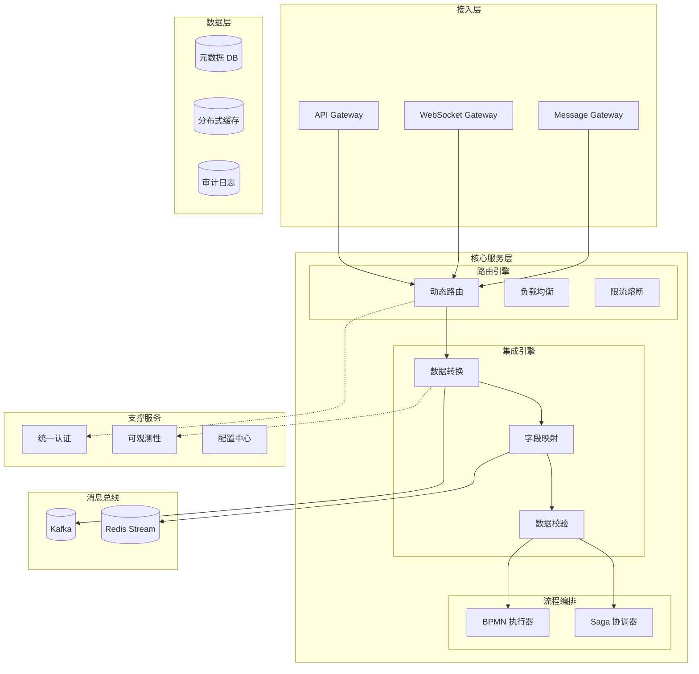
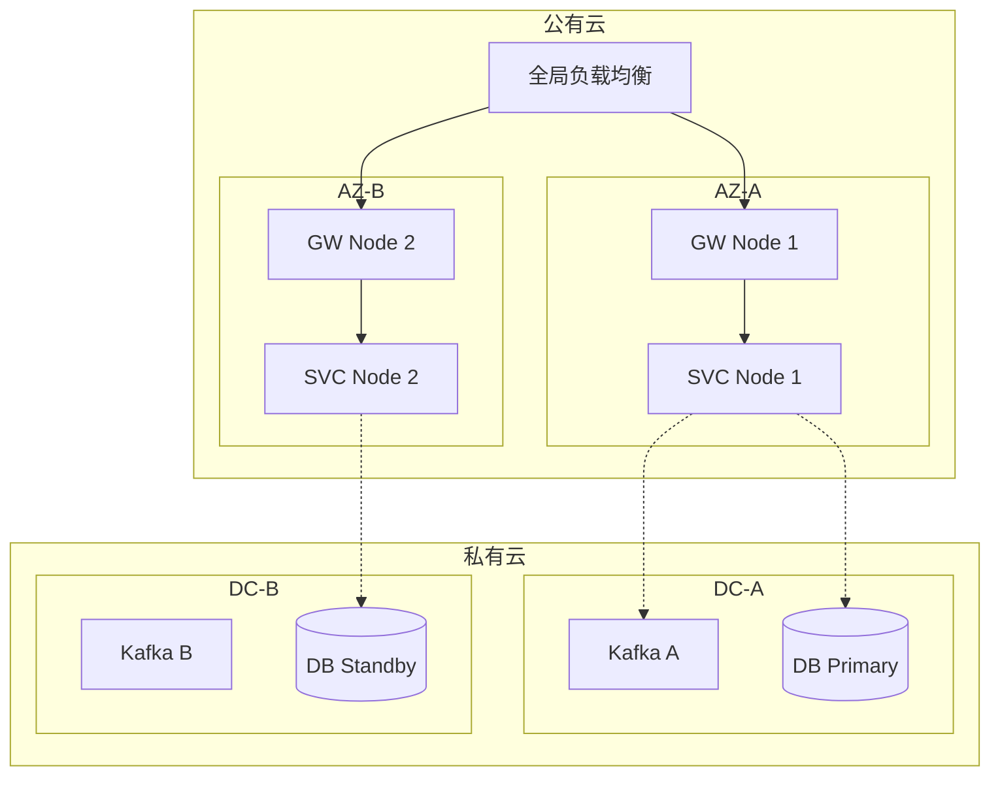

# 企业多系统连接中枢 — 总体架构设计文档 (HLD)

> **文档版本**: V1.0  
> **编制日期**: 2026-04-10  
> **状态**: 草稿  

---

## 1. 架构设计原则

| 原则 | 描述 | 业务映射 |
|------|------|----------|
| 松耦合 | 系统间通过契约接口通信，无直接依赖 | 快速扩展 |
| 弹性设计 | 故障隔离，自动恢复，熔断降级 | 高可用保障 |
| 安全内生 | 安全能力内置而非外挂，零信任架构 | 安全合规 |
| 可观测性 | 全链路可度量、可追踪、可诊断 | 运维提效 |
| 云原生 | 容器化部署，声明式配置，自动扩缩容 | 敏捷交付 |

---

## 2. 逻辑架构

---

## 3. 部署架构

-   **多可用区部署**: 保证单 AZ 故障不影响服务。
-   **混合云架构**: 核心数据存私有云，计算资源弹性扩展至公有云。
-   **数据同步**: DB 主从异步复制，Kafka 跨集群 MirrorMaker 2.0 同步。

---

## 4. 技术选型

### 4.1 API 网关
| 方案 | 性能 | 动态配置 | 生态 | 决策 |
|------|------|----------|------|------|
| Kong | 30k QPS | 部分热更新 | 丰富 | - |
| **APISIX** | **40k QPS** | **全热更新** | **丰富** | **✅ 选中** |
| Envoy | 45k QPS | xDS 热更新 | 中等 | - |

**理由**: APISIX 全热更新满足配置实时生效，性能优异，国内社区活跃。

### 4.2 消息中间件
| 方案 | 吞吐量 | 延迟 | 运维 | 决策 |
|------|--------|------|------|------|
| **Kafka** | **1M+ msg/s** | **10ms** | **中等** | **✅ 选中** |
| RabbitMQ | 50k msg/s | 5ms | 低 | - |
| Pulsar | 500k msg/s | 8ms | 高 | - |

**理由**: Kafka 吞吐量最高，生态最完善，Exactly-Once 保障数据一致性。

### 4.3 流程编排
| 方案 | 标准 | 实时性 | 事务 | 决策 |
|------|------|--------|------|------|
| **Camunda 8** | **BPMN 2.0** | **亚秒级** | **原生 Saga** | **✅ 选中** |
| Airflow | DAG | 分钟级 | 无 | - |
| Conductor | JSON DSL | 秒级 | 支持 | - |

**理由**: Camunda 8 符合国际标准 BPMN 2.0，原生支持 Saga 事务，云原生架构。

---

## 5. 容量规划

| 资源 | 初期 | 1 年 | 3 年 | 扩展策略 |
|------|------|------|------|----------|
| API 网关 | 4 节点 | 8 节点 | 16 节点 | HPA 自动扩缩容 |
| 核心服务 | 4 节点 | 8 节点 | 20 节点 | HPA 自动扩缩容 |
| Kafka | 3 Broker | 6 Broker | 9 Broker | 增加分区 |
| DB | 1 主 2 从 | 1 主 3 从 | 读写分离 | 垂直 + 水平扩展 |

---

## 6. 架构决策记录 (ADR)

| 编号 | 决策 | 背景 | 后果 |
|------|------|------|------|
| ADR-001 | 采用 Kafka KRaft 模式 | 消除 ZooKeeper 依赖 | 降低运维复杂度 30% |
| ADR-002 | 采用 Saga 模式处理分布式事务 | 2PC 性能差，阻塞严重 | 实现最终一致性，需补偿逻辑 |
| ADR-003 | 采用 OpenTelemetry 作为追踪标准 | 避免厂商锁定 | 统一可观测性数据模型 |
