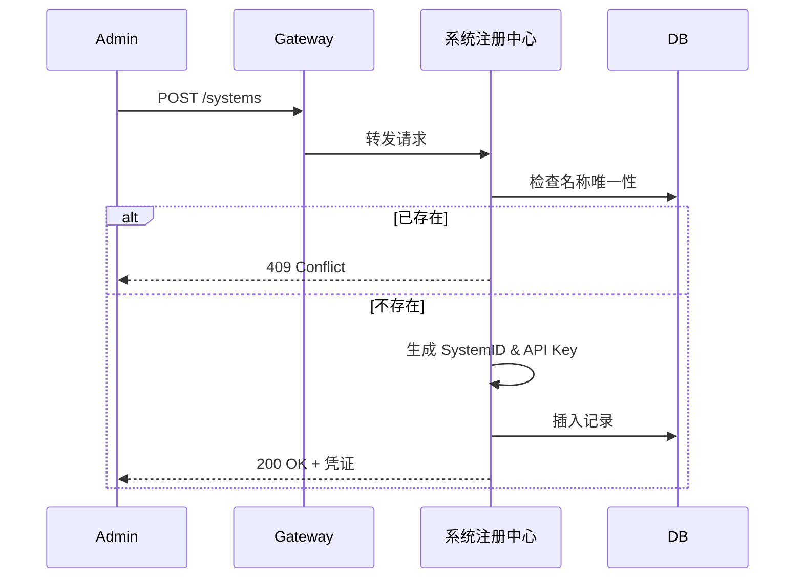
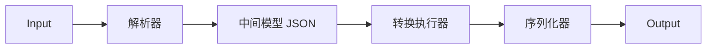
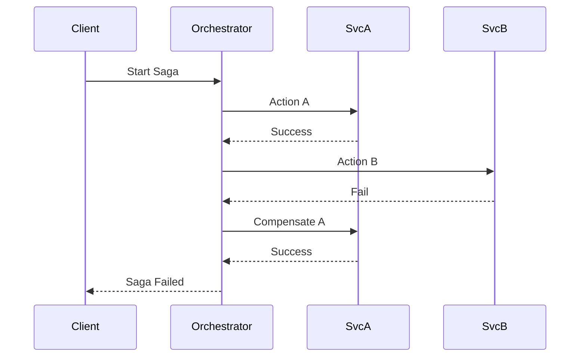
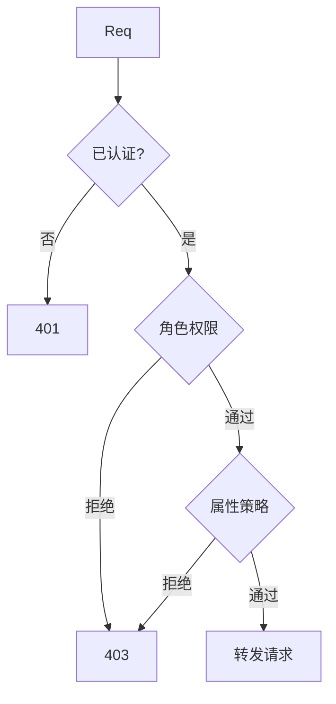

# 企业多系统连接中枢 — 详细设计文档 (LLD)

> **文档版本**: V1.0  
> **编制日期**: 2026-04-10  
> **状态**: 草稿  

---

## 1. 模块划分

| 模块 | 子模块 | 职责 |
|------|--------|------|
| M1 接入管理 | 系统注册、API 管理、连接器管理、协议适配 | 外部系统接入与元数据管理 |
| M2 路由负载 | 动态路由、负载均衡、流量控制、灰度发布 | 请求分发与流量治理 |
| M3 数据集成 | 数据转换、字段映射、数据校验、批量处理 | 异构数据清洗与转换 |
| M4 流程编排 | BPMN 设计器、流程执行、Saga 协调、事件驱动 | 业务流程编排与事务管理 |
| M5 安全管控 | 统一认证、权限管理、加解密、审计日志 | 身份安全与合规审计 |
| M6 可观测性 | 指标采集、链路追踪、日志聚合、智能告警 | 系统监控与故障诊断 |
| M7 运维管理 | 配置中心、健康检查、版本管理、容量管理 | 系统运维与生命周期管理 |

---

## 2. M1 接入管理详细设计

### 2.1 系统注册流程


### 2.2 核心数据结构
**SystemEntity**:
| 字段 | 类型 | 约束 | 说明 |
|------|------|------|------|
| system_id | UUID | PK | 全局唯一标识 |
| system_name | String(64) | Unique, Not Null | 系统名称 |
| protocol | Enum | Not Null | REST/gRPC/AMQP |
| auth_config | JSON | Not Null | 加密存储认证信息 |
| status | Enum | Not Null | Registered/Active/Inactive |

---

## 3. M2 路由与流量控制详细设计

### 3.1 动态路由匹配算法
采用**规则树 (Rule Tree)** 匹配，优先级:
1.  精确匹配 (Path)
2.  前缀匹配 (Path Prefix)
3.  Header 匹配 (灰度/多租户)
4.  权重路由 (Canary)

### 3.2 限流算法实现
-   **令牌桶**: 适用于允许突发流量的场景。
    ```java
    class TokenBucket {
        long capacity;
        long tokens;
        long refillRate;
        long lastRefillTime;
        
        boolean tryConsume() {
            refill();
            if (tokens > 0) {
                tokens--;
                return true;
            }
            return false;
        }
    }
    ```
-   **熔断器状态机**: Closed -> Open (失败率>50%) -> HalfOpen (60s 后) -> Closed/Open。

---

## 4. M3 数据集成详细设计

### 4.1 转换引擎架构


### 4.2 字段映射执行
1.  加载映射规则 (JSONPath + 表达式)。
2.  构建映射 DAG (有向无环图)。
3.  按拓扑排序顺序执行转换函数。
4.  组装目标对象。

### 4.3 校验失败策略
-   **Reject**: 进入死信队列 (DLQ)。
-   **Default**: 使用默认值。
-   **Alert**: 记录告警并继续。

---

## 5. M4 流程编排与 Saga 详细设计

### 5.1 Saga 事务协调


### 5.2 补偿机制
-   每个 Action 必须定义 `CompensationAction`。
-   补偿失败重试 3 次，仍失败则转入人工处理队列。

---

## 6. M5 安全管控详细设计

### 6.1 鉴权流程


### 6.2 审计日志防篡改
-   日志写入后计算 `Hash(Current) = SHA256(Content + Hash(Previous))`。
-   形成哈希链，任何修改都会导致后续哈希不匹配。

---

## 7. 异常处理与重试

### 7.1 全局异常拦截
统一捕获异常，返回标准错误格式:
```json
{
  "error": { "code": "4001", "message": "...", "trace_id": "..." }
}
```

### 7.2 重试策略
-   **指数退避**: `delay = base_delay * 2^attempt`。
-   **最大重试**: 3 次。
-   **幂等性**: 通过 `Idempotency-Key` Header 保证。
