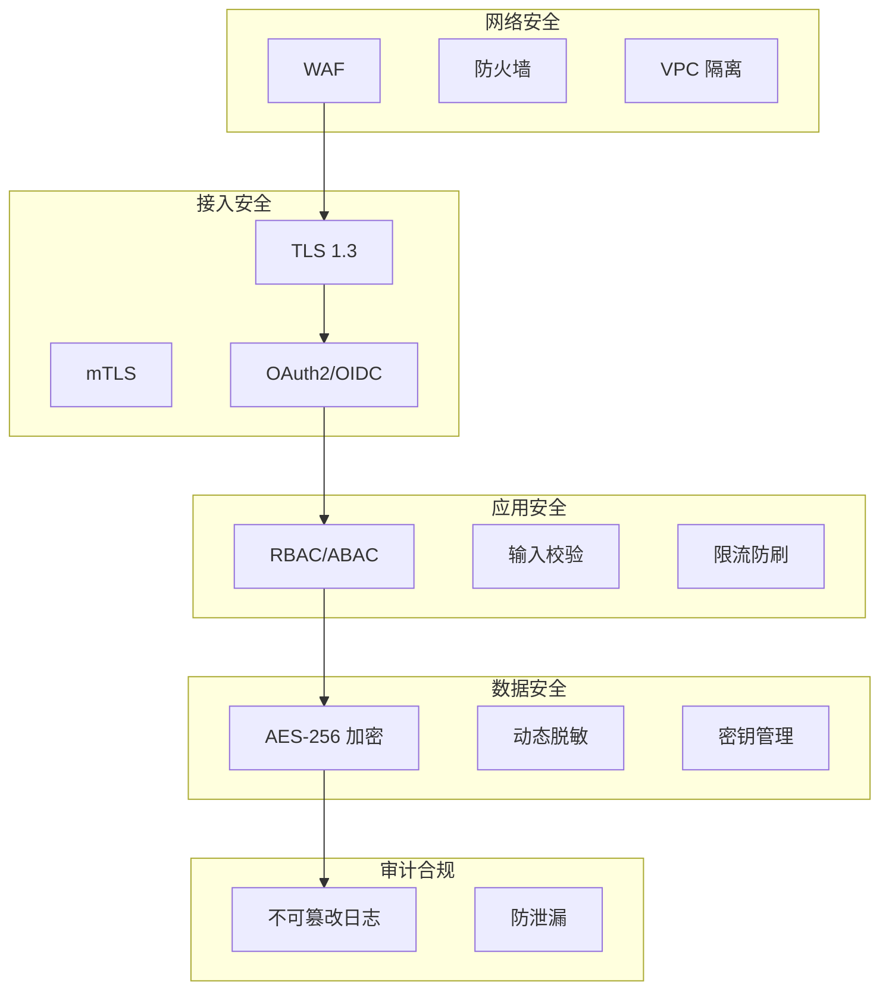

# 企业多系统连接中枢 — 安全设计文档 (Security Design)

> **文档版本**: V1.0  
> **编制日期**: 2026-04-10  
> **状态**: 草稿  

---

## 1. 安全架构概述

本系统采用**零信任 (Zero Trust)** 安全架构，遵循"永不信任，始终验证"原则。安全能力内生，覆盖网络、接入、应用、数据、审计五层防护。

### 1.1 安全分层

---

## 2. 身份认证与授权

### 2.1 认证协议
-   **OAuth 2.0**: 授权码模式 (Authorization Code) 用于 Web 应用，客户端凭证模式 (Client Credentials) 用于系统间调用。
-   **OIDC**: 在 OAuth 2.0 基础上提供身份验证，返回 ID Token (JWT)。
-   **mTLS**: 系统间通信采用双向 TLS 认证，验证客户端证书。

### 2.2 认证流程
1.  客户端请求受保护资源。
2.  网关拦截请求，检查 `Authorization` Header。
3.  若无 Token 或无效，重定向至 Keycloak 登录页。
4.  用户认证成功，Keycloak 返回 Access Token。
5.  网关验证 Token 签名及有效期，放行请求。

### 2.3 权限模型
-   **RBAC (基于角色)**: 用户 -> 角色 -> 权限 (API 级别)。
-   **ABAC (基于属性)**: 结合用户属性 (部门、职级)、资源属性 (敏感度)、环境属性 (时间、IP) 进行动态决策。
-   **策略引擎**: 使用 OPA (Open Policy Agent) 执行 Rego 策略。

---

## 3. 数据安全

### 3.1 加密策略
| 场景 | 算法 | 密钥管理 |
|------|------|----------|
| 传输加密 | TLS 1.3 | 证书自动轮换 (Let's Encrypt / 内部 CA) |
| 存储加密 | AES-256-GCM | HashiCorp Vault 动态密钥，90 天轮换 |
| 密码存储 | Argon2id | 随机盐值，高强度哈希 |
| 数据签名 | RSA-SHA256 | 私钥 Vault 存储，公钥公开 |

### 3.2 敏感数据脱敏
-   **静态脱敏**: 数据库存储时对手机号、身份证等进行掩码处理。
-   **动态脱敏**: API 响应时根据用户权限动态隐藏敏感字段。
    -   例: 普通用户看到 `138****1234`，管理员看到完整号码。

### 3.3 密钥管理 (Vault)
-   所有密钥、密码、Token 统一由 Vault 管理。
-   应用启动时通过 AppRole 认证获取动态密钥。
-   禁止硬编码密钥，禁止日志打印密钥。

---

## 4. 应用安全

### 4.1 输入校验
-   所有外部输入必须经过严格校验 (JSON Schema, 白名单)。
-   防止 SQL 注入、XSS、命令注入。
-   文件上传限制类型、大小，扫描病毒。

### 4.2 流量控制
-   **限流**: 令牌桶算法，防止 API 滥用。
-   **防重放**: 请求携带 `Nonce` 和 `Timestamp`，服务端校验唯一性和时效性。
-   **CSRF 防护**: 关键操作验证 CSRF Token。

### 4.3 依赖安全
-   CI/CD 流水线集成 SAST (SonarQube) 和 SCA (Snyk/Trivy)。
-   禁止使用含高危漏洞的依赖。
-   定期更新基础镜像和组件版本。

---

## 5. 审计与合规

### 5.1 审计日志
-   **记录内容**: 谁 (User)、何时 (Time)、何地 (IP)、做了什么 (Action)、结果如何 (Result)。
-   **防篡改**: 日志写入后计算哈希链，任何修改都会破坏链式结构。
-   **存储**: 写入 Elasticsearch，采用 WORM (Write Once Read Many) 策略。

### 5.2 合规映射
| 合规标准 | 控制措施 | 实现方式 |
|----------|----------|----------|
| ISO 27001 | 访问控制、加密、审计 | RBAC, AES-256, 审计日志 |
| GDPR | 数据最小化、被遗忘权 | 动态脱敏、数据删除接口 |
| PCI DSS | 支付数据保护 | 令牌化、网络隔离 |
| 等保 2.0 | 三级安全要求 | 身份鉴别、安全审计、入侵防范 |

---

## 6. 安全事件响应

### 6.1 响应流程
1.  **检测**: SIEM 系统监测异常行为或攻击特征。
2.  **隔离**: 自动隔离受感染节点或封禁恶意 IP。
3.  **分析**: 安全团队分析日志，确定攻击路径和影响范围。
4.  **恢复**: 清除威胁，恢复数据，验证系统完整性。
5.  **复盘**: 编写事故报告，优化防御策略。

### 6.2 应急预案
| 场景 | 响应动作 | 责任人 |
|------|----------|--------|
| 密钥泄露 | 立即轮换密钥，吊销旧 Token | 安全工程师 |
| 数据泄露 | 隔离系统，通知合规团队，启动 DLP | 安全工程师 |
| DDoS 攻击 | 启用高防 IP，限流降级 | 运维工程师 |
| 漏洞利用 | 热修复或回滚，打补丁 | 开发团队 |
