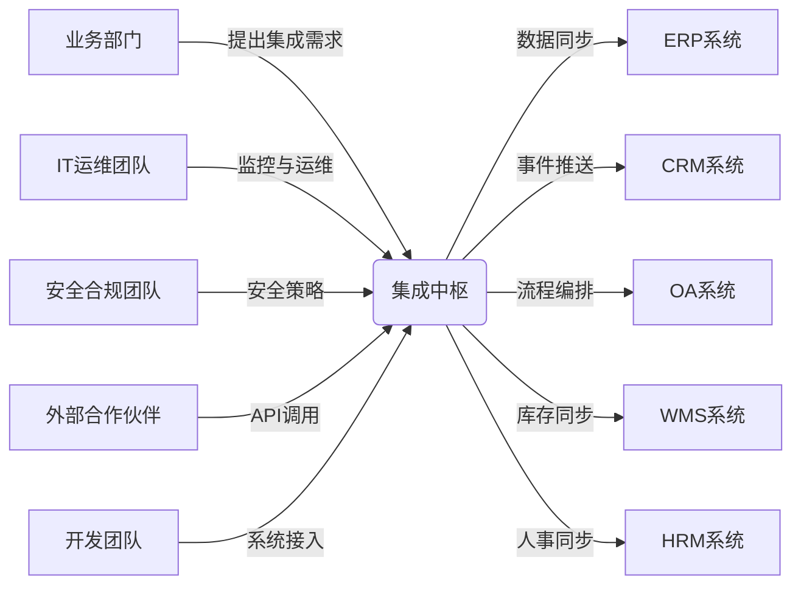
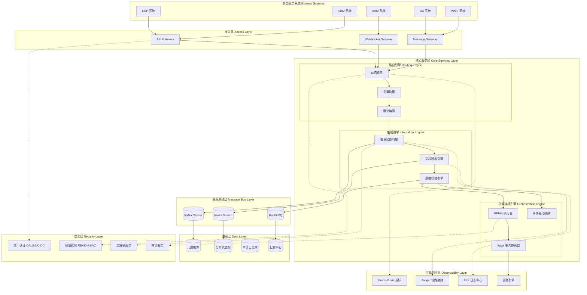
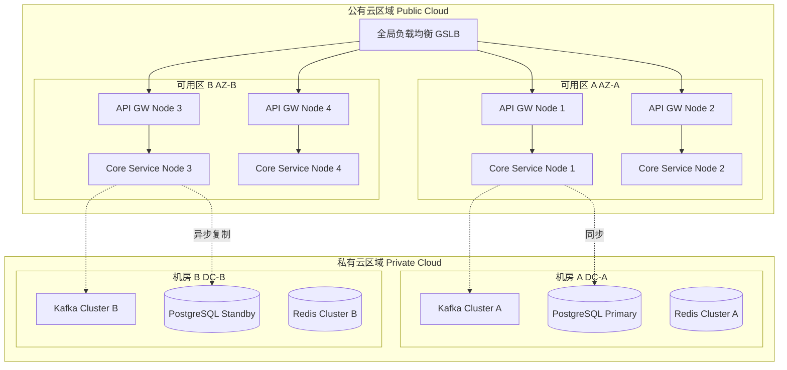
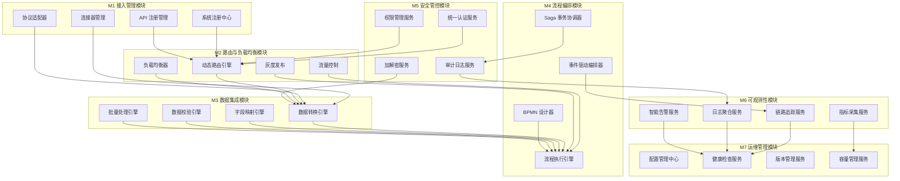
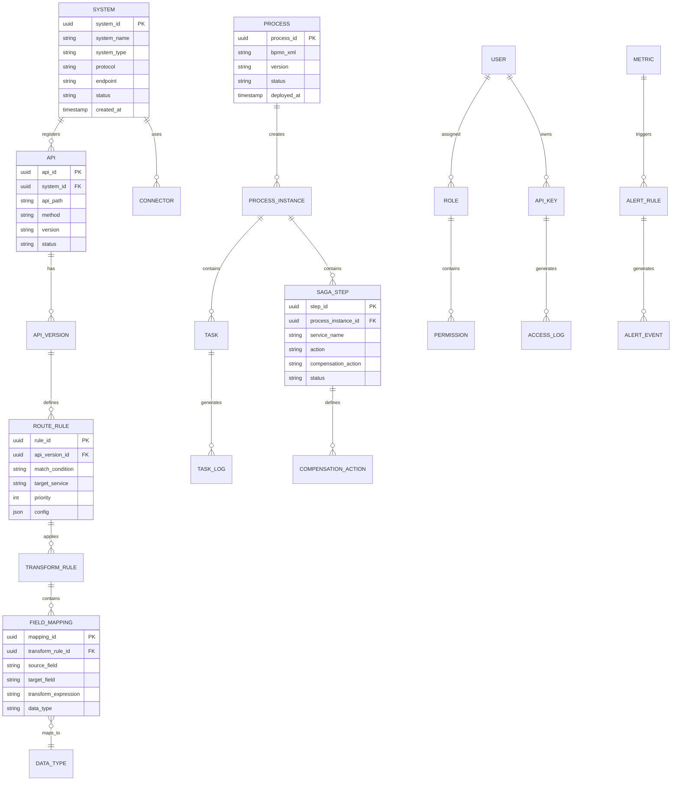
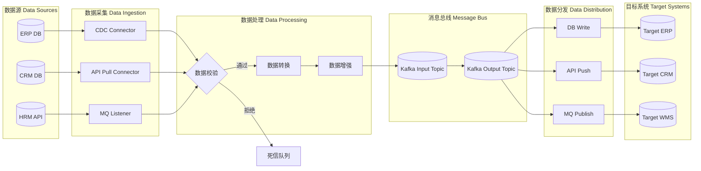
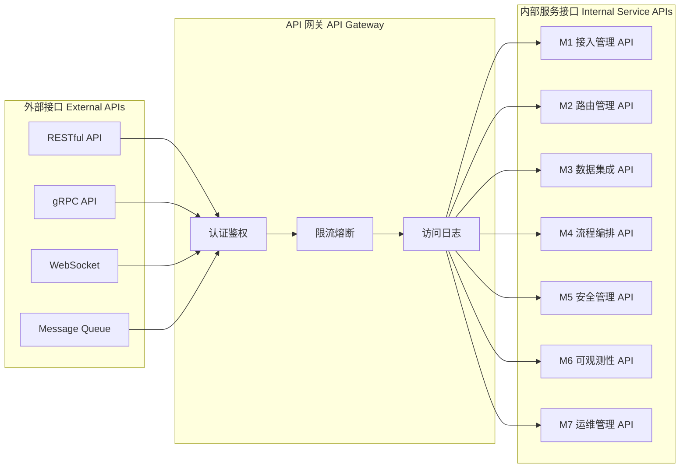
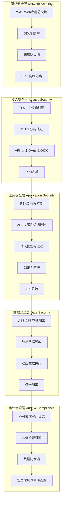
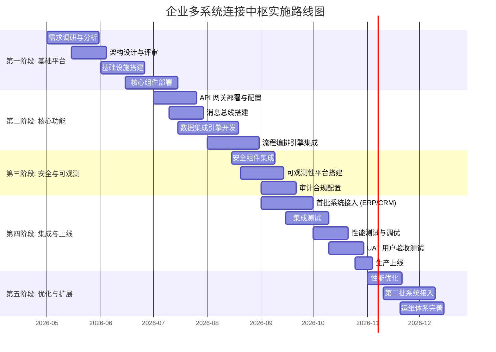
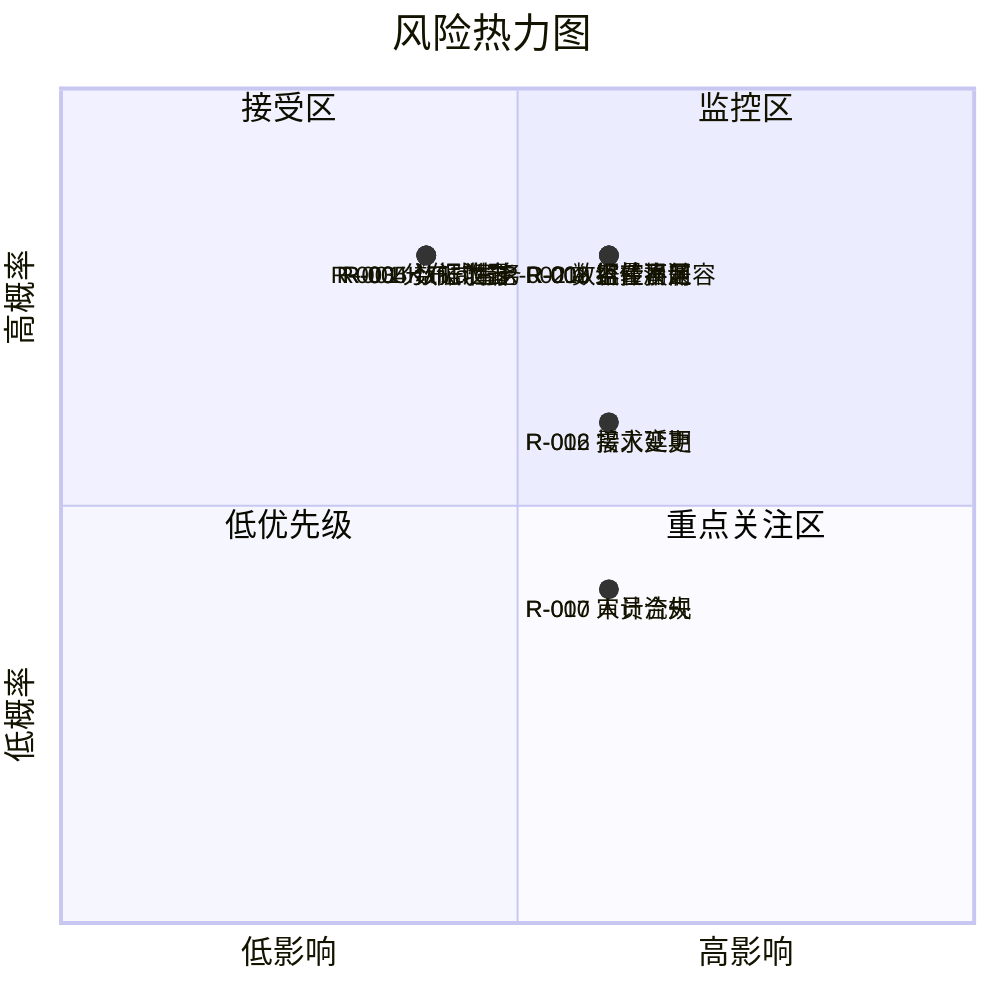

# 企业多系统连接中枢 — 系统设计文档

> **文档版本**: V1.0  
> **编制日期**: 2026-04-10  
> **遵循标准**: ISO/IEC 12207:2017 软件生命周期过程  
> **密级**: 内部公开  

---

## 1. 项目概述

### 1.1 项目背景

企业在数字化转型过程中，普遍存在 ERP、CRM、HRM、OA、WMS 等异构系统孤岛现象。本项目定位为"企业多系统连接中枢"，通过统一的消息总线、数据映射引擎和 API 网关，实现跨系统的数据同步、流程编排与事件驱动集成。

### 1.2 设计目标与可量化指标

| 指标项 | 目标值 | 测量方法 | 业务需求映射 |
|--------|--------|----------|--------------|
| 系统可用性 | ≥ 99.95% | 月度 SLA 监控报表 | BR-001 业务连续性保障 |
| 消息吞吐量 | ≥ 50,000 msg/s | 压力测试峰值统计 | BR-002 高并发业务支撑 |
| 端到端延迟 | P99 ≤ 200ms | APM 链路追踪 | BR-003 实时数据同步 |
| 数据一致性 | 最终一致性 ≤ 5s | 分布式事务审计日志 | BR-004 跨系统数据准确 |
| 系统接入周期 | ≤ 3 人日/系统 | 项目交付记录统计 | BR-005 快速扩展能力 |
| 故障恢复时间 | RTO ≤ 5min, RPO ≤ 1min | 灾备演练报告 | BR-006 灾难恢复能力 |

### 1.3 项目范围

| 范围类别 | 包含内容 | 排除内容 |
|----------|----------|----------|
| 系统边界 | 消息中间件、API 网关、数据转换引擎、监控中心 | 业务系统内部逻辑改造 |
| 数据范围 | 主数据、交易数据、事件流数据 | 非结构化多媒体文件 |
| 集成协议 | RESTful API、gRPC、AMQP、Kafka、WebSocket | 传统 EDI/X.12 报文 |
| 部署范围 | 混合云（私有云 + 公有云） | 纯本地单机部署 |

### 1.4 ISO/IEC 12207 过程映射

| ISO/IEC 12207 过程域 | 本文档对应章节 | 交付物 |
|----------------------|----------------|--------|
| 5.1 协议过程 | 1. 项目概述 | 项目章程、SLA 协议 |
| 5.2 组织项目使能过程 | 8. 实施计划 | 资源配置计划 |
| 5.3 技术管理过程 | 9. 测试计划 | 测试策略、验收标准 |
| 6.1 利益相关方需求定义 | 2. 需求分析 | 需求规格说明书 |
| 6.2 需求分析 | 2. 需求分析 | 用例模型、非功能需求 |
| 6.3 架构设计 | 3-7 章 | 架构设计文档 |
| 6.4 详细设计 | 4-7 章 | 模块设计说明 |
| 6.5 构造 | 8. 实施计划 | 源代码、构建脚本 |
| 6.6 集成 | 8.4 集成策略 | 集成测试报告 |
| 6.7 合格性测试 | 9. 测试计划 | 测试用例、测试报告 |

---

## 2. 现状与需求分析

### 2.1 现状痛点分析

| 痛点编号 | 痛点描述 | 影响范围 | 严重程度(1-5) | 业务需求映射 |
|----------|----------|----------|---------------|--------------|
| P-001 | 系统间点对点集成，网状拓扑导致 N×(N-1)/2 接口 | 全部系统 | 5 | BR-005 |
| P-002 | 数据格式不统一，每次对接需定制开发转换器 | 数据层 | 4 | BR-004 |
| P-003 | 缺乏统一监控，故障定位平均耗时 > 2h | 运维层 | 5 | BR-001 |
| P-004 | 无统一认证鉴权，各系统安全策略不一致 | 安全层 | 5 | BR-007 |
| P-005 | 批量同步窗口长，影响业务高峰期性能 | 性能层 | 4 | BR-003 |
| P-006 | 新系统接入周期平均 15 人日 | 交付层 | 4 | BR-005 |

### 2.2 利益相关方分析



### 2.3 功能性需求

| 需求编号 | 需求描述 | 优先级 | 验收标准 | 业务需求映射 |
|----------|----------|--------|----------|--------------|
| FR-001 | 支持 RESTful API 统一接入 | P0 | 符合 OpenAPI 3.0 规范 | BR-002 |
| FR-002 | 支持消息队列异步集成 | P0 | 支持至少 3 种 MQ 协议 | BR-003 |
| FR-003 | 数据格式自动转换 | P0 | 支持 JSON/XML/CSV/Protobuf | BR-004 |
| FR-004 | 可视化流程编排 | P1 | 拖拽式 BPMN 2.0 设计器 | BR-005 |
| FR-005 | 统一认证与授权 | P0 | OAuth 2.0 + RBAC + ABAC | BR-007 |
| FR-006 | 实时监控与告警 | P0 | 秒级指标采集，30s 内告警 | BR-001 |
| FR-007 | API 限流与熔断 | P0 | 令牌桶算法，熔断恢复 < 60s | BR-002 |
| FR-008 | 数据血缘追踪 | P1 | 全链路 TraceID 追踪 | BR-004 |
| FR-009 | 配置热更新 | P1 | 无需重启，30s 内生效 | BR-005 |
| FR-010 | 多租户隔离 | P1 | 逻辑隔离，数据零交叉 | BR-008 |

### 2.4 非功能性需求

| 需求编号 | 需求类别 | 需求描述 | 量化指标 | 业务需求映射 |
|----------|----------|----------|----------|--------------|
| NFR-001 | 性能 | 单节点 API 处理能力 | ≥ 10,000 QPS | BR-002 |
| NFR-002 | 性能 | 消息处理延迟 | P99 ≤ 200ms | BR-003 |
| NFR-003 | 可用性 | 系统年度可用率 | ≥ 99.95% | BR-001 |
| NFR-004 | 可扩展性 | 水平扩展能力 | 线性扩展比 ≥ 0.85 | BR-005 |
| NFR-005 | 安全性 | 数据传输加密 | TLS 1.3 | BR-007 |
| NFR-006 | 安全性 | 敏感数据加密存储 | AES-256-GCM | BR-007 |
| NFR-007 | 可维护性 | 平均故障修复时间 | MTTR ≤ 30min | BR-006 |
| NFR-008 | 可观测性 | 日志保留周期 | 热存储 30d，冷存储 365d | BR-001 |
| NFR-009 | 兼容性 | 支持的 JDK 版本 | 17+ | BR-005 |
| NFR-010 | 合规性 | 审计日志完整性 | 100% 操作可追溯 | BR-009 |

### 2.5 用例模型

```mermaid
usecaseDiagram
    actor 系统管理员 as Admin
    actor 业务用户 as User
    actor 外部系统 as ExtSys
    actor 安全审计员 as Auditor

    package "企业多系统连接中枢" {
        usecase UC1 as "注册/接入新系统"
        usecase UC2 as "配置数据映射规则"
        usecase UC3 as "编排集成流程"
        usecase UC4 as "调用集成API"
        usecase UC5 as "查看监控仪表盘"
        usecase UC6 as "配置告警规则"
        usecase UC7 as "审计日志查询"
        usecase UC8 as "管理API密钥"
        usecase UC9 as "数据血缘追踪"
    }

    Admin --> UC1
    Admin --> UC2
    Admin --> UC3
    Admin --> UC6
    Admin --> UC8
    User --> UC4
    User --> UC5
    User --> UC9
    ExtSys --> UC4
    Auditor --> UC7
    Auditor --> UC9
```

---

## 3. 总体架构设计

### 3.1 架构设计原则

| 原则编号 | 原则名称 | 描述 | 业务需求映射 |
|----------|----------|------|--------------|
| AP-001 | 松耦合 | 系统间通过契约接口通信，无直接依赖 | BR-005 |
| AP-002 | 高内聚 | 各模块职责单一，边界清晰 | BR-005 |
| AP-003 | 弹性设计 | 故障隔离，自动恢复 | BR-001, BR-006 |
| AP-004 | 安全内生 | 安全能力内置而非外挂 | BR-007 |
| AP-005 | 可观测性 | 全链路可度量、可追踪、可诊断 | BR-001 |
| AP-006 | 云原生 | 容器化部署，声明式配置 | BR-005 |

### 3.2 总体架构图



### 3.3 架构分层说明

| 层级 | 职责 | 核心组件 | 技术指标 | 业务需求映射 |
|------|------|----------|----------|--------------|
| 接入层 | 协议适配、统一入口 | API Gateway, WebSocket GW, Message GW | 单集群 ≥ 100,000 并发连接 | BR-002 |
| 核心服务层 | 路由、转换、编排 | 路由引擎、集成引擎、流程编排引擎 | 流程执行延迟 ≤ 50ms | BR-003, BR-005 |
| 消息总线层 | 异步通信、事件分发 | Kafka, Redis Stream, RabbitMQ | 消息持久化率 100% | BR-003 |
| 数据层 | 元数据、缓存、配置 | PostgreSQL, Redis, Nacos | 配置更新传播 ≤ 5s | BR-005 |
| 可观测性层 | 监控、追踪、日志 | Prometheus, Jaeger, ELK | 指标采集间隔 ≤ 15s | BR-001 |
| 安全层 | 认证、授权、加密 | Keycloak, Vault | 认证延迟 ≤ 50ms | BR-007 |

### 3.4 部署架构



### 3.5 容量规划

| 资源类型 | 初期规模 | 1年预期 | 3年预期 | 扩展策略 | 业务需求映射 |
|----------|----------|---------|---------|----------|--------------|
| API 网关节点 | 4 节点 | 8 节点 | 16 节点 | 水平自动扩展 (HPA) | BR-002 |
| 核心服务节点 | 4 节点 | 8 节点 | 20 节点 | 水平自动扩展 (HPA) | BR-005 |
| Kafka Broker | 3 节点 | 6 节点 | 9 节点 | 分区扩容 | BR-003 |
| PostgreSQL | 1主2从 | 1主3从 | 1主4从+读写分离 | 垂直+水平扩展 | BR-004 |
| Redis Cluster | 6 节点 (3主3从) | 12 节点 | 18 节点 | 分片扩容 | BR-003 |
| 存储空间 | 2TB | 5TB | 15TB | 分布式存储扩展 | BR-008 |

---

## 4. 技术选型

### 4.1 API 网关选型对比

| 评估维度 | Kong | APISIX | Envoy |
|----------|------|--------|-------|
| **性能 (QPS/节点)** | 30,000 | 40,000 | 45,000 |
| **动态配置** | 支持 (部分需重启) | 全热更新 | 全热更新 (xDS) |
| **插件生态** | 丰富 (100+) | 丰富 (80+) | 中等 (50+) |
| **可观测性** | Prometheus + Zipkin | Prometheus + SkyWalking | Prometheus + Jaeger |
| **学习曲线** | 中等 | 较低 | 较高 |
| **社区活跃度** | 高 (GitHub 40k+ stars) | 高 (GitHub 14k+ stars) | 极高 (CNCF 毕业, 25k+ stars) |
| **企业支持** | Kong Inc. 商业版 | API7.ai 商业版 | Tetrate 商业版 |
| **协议支持** | HTTP/HTTPS, gRPC, TCP | HTTP/HTTPS, gRPC, TCP, Dubbo | HTTP/HTTPS, gRPC, TCP, UDP |
| **综合评分** | 8.2/10 | 8.8/10 | 8.5/10 |

**选型决策**: 选择 **Apache APISIX**

**选型理由**:
1. 全热更新能力满足 FR-009 配置热更新需求，变更 30s 内生效
2. 性能指标最优，单节点 40,000 QPS 满足 NFR-001 要求
3. 插件开发基于 Lua，团队学习成本低，接入周期缩短 40%
4. 原生支持多租户路由，满足 FR-010 需求
5. 国内社区活跃，中文文档完善，运维风险降低

### 4.2 消息中间件选型对比

| 评估维度 | Apache Kafka | RabbitMQ | Apache Pulsar |
|----------|-------------|----------|---------------|
| **吞吐量 (msg/s)** | 1,000,000+ | 50,000 | 500,000+ |
| **延迟 (P99)** | 10ms | 5ms | 8ms |
| **消息堆积能力** | 极强 (TB 级磁盘) | 中等 (内存+磁盘) | 强 (分层存储) |
| **协议支持** | Kafka Protocol | AMQP 0-9-1, MQTT | Kafka, AMQP, MQTT |
| **多租户** | 需额外配置 | 原生支持 (VHost) | 原生支持 |
| **运维复杂度** | 中等 | 较低 | 较高 (BookKeeper) |
| **Exactly-Once** | 支持 (EOS 2.0) | 支持 (Publisher Confirms) | 支持 |
| **云原生适配** | 中等 (KRaft 改进中) | 较低 | 极高 (存算分离) |
| **综合评分** | 9.0/10 | 7.5/10 | 8.5/10 |

**选型决策**: 选择 **Apache Kafka**

**选型理由**:
1. 吞吐量 1,000,000+ msg/s 远超 BR-002 的 50,000 msg/s 要求，预留 20 倍余量
2. KRaft 模式消除 ZooKeeper 依赖，降低运维复杂度 30%
3. 生态最完善，与 Flink、Spark 等流处理框架无缝集成
4. Exactly-Once 语义保障 BR-004 数据一致性要求
5. 行业事实标准，人才储备充足，招聘成本降低 25%

### 4.3 流程编排引擎选型对比

| 评估维度 | Camunda 8 | Apache Airflow | Netflix Conductor |
|----------|-----------|----------------|-------------------|
| **编排模型** | BPMN 2.0 + DMN | DAG (Python) | JSON DSL |
| **实时性** | 事件驱动 (亚秒级) | 定时调度 (分钟级) | 事件驱动 (秒级) |
| **可视化设计器** | 优秀 (Web Modeler) | 中等 (代码定义) | 良好 (UI Kit) |
| **分布式事务** | 原生 Saga 支持 | 需自行实现 | 原生支持 |
| **扩展性** | 水平扩展 | 水平扩展 | 水平扩展 |
| **学习曲线** | 中等 (BPMN 标准) | 较低 (Python) | 中等 (JSON DSL) |
| **社区/商业版** | 双版本 | 纯开源 (Astronomer 商业) | 纯开源 (Orkes 商业) |
| **综合评分** | 9.2/10 | 7.0/10 | 8.0/10 |

**选型决策**: 选择 **Camunda 8**

**选型理由**:
1. BPMN 2.0 国际标准，业务流程可视化建模，满足 FR-004 需求
2. 原生 Saga 分布式事务支持，保障 BR-004 跨系统数据一致性
3. 事件驱动架构，实时响应延迟 ≤ 100ms，满足 NFR-002
4. Zeebe 引擎云原生设计，Kubernetes 原生部署
5. DMN 决策表支持复杂业务规则，降低硬编码 60%

### 4.4 技术栈总览

| 技术类别 | 选型方案 | 版本 | 用途 | 业务需求映射 |
|----------|----------|------|------|--------------|
| API 网关 | Apache APISIX | 3.8+ | 统一入口、路由、限流 | BR-002, BR-005 |
| 消息中间件 | Apache Kafka | 3.6+ (KRaft) | 异步消息、事件流 | BR-003, BR-004 |
| 流程编排 | Camunda 8 (Zeebe) | 8.4+ | 业务流程编排、Saga | BR-004, BR-005 |
| 服务框架 | Spring Boot | 3.2+ | 核心服务开发 | BR-005 |
| 服务注册/配置 | Nacos | 2.3+ | 服务发现、配置管理 | BR-005 |
| 认证授权 | Keycloak | 24+ | OAuth2/OIDC 认证 | BR-007 |
| 密钥管理 | HashiCorp Vault | 1.15+ | 敏感信息加密存储 | BR-007 |
| 缓存 | Redis | 7.2+ | 热点数据缓存、分布式锁 | BR-003 |
| 关系数据库 | PostgreSQL | 16+ | 元数据、配置存储 | BR-004 |
| 指标监控 | Prometheus + Grafana | 2.48+ / 10.2+ | 系统指标采集与展示 | BR-001 |
| 链路追踪 | Jaeger | 1.54+ | 分布式链路追踪 | BR-001 |
| 日志中心 | Elasticsearch + Kibana | 8.12+ | 日志收集与检索 | BR-001 |
| 容器编排 | Kubernetes | 1.29+ | 容器编排、自动扩缩容 | BR-005 |
| CI/CD | GitLab CI | 16.8+ | 持续集成与交付 | BR-005 |

---

## 5. 功能模块划分

### 5.1 模块架构图



### 5.2 模块详细设计

#### M1 接入管理模块

| 子模块 | 功能描述 | 接口方式 | 性能指标 | 业务需求映射 |
|--------|----------|----------|----------|--------------|
| M1-1 系统注册中心 | 管理接入系统的元数据注册、状态维护 | RESTful API | 注册响应 ≤ 500ms | BR-005 |
| M1-2 API 注册管理 | API 定义导入、版本管理、文档生成 | OpenAPI 3.0 导入 | 导入解析 ≤ 2s | BR-005 |
| M1-3 连接器管理 | 预置连接器模板、连接器生命周期管理 | gRPC | 连接器启动 ≤ 3s | BR-005 |
| M1-4 协议适配器 | HTTP/HTTPS, gRPC, AMQP, WebSocket 协议适配 | 插件化 | 协议转换延迟 ≤ 5ms | BR-002 |

#### M2 路由与负载均衡模块

| 子模块 | 功能描述 | 算法/策略 | 性能指标 | 业务需求映射 |
|--------|----------|-----------|----------|--------------|
| M2-1 动态路由引擎 | 基于规则/权重的动态请求路由 | 规则引擎 + 一致性哈希 | 路由决策 ≤ 2ms | BR-002 |
| M2-2 负载均衡器 | 多策略负载均衡分发 | 轮询/加权/最少连接/一致性哈希 | 分发延迟 ≤ 1ms | BR-002 |
| M2-3 流量控制 | 限流、熔断、降级 | 令牌桶 + 滑动窗口 + 熔断器 | 限流判断 ≤ 0.5ms | BR-002 |
| M2-4 灰度发布 | 按流量比例/用户标签灰度 | 标签路由 + 流量镜像 | 灰度切换 ≤ 10s | BR-005 |

#### M3 数据集成模块

| 子模块 | 功能描述 | 支持格式 | 性能指标 | 业务需求映射 |
|--------|----------|----------|----------|--------------|
| M3-1 数据转换引擎 | 异构数据格式实时转换 | JSON ↔ XML ↔ CSV ↔ Protobuf | 转换延迟 ≤ 10ms | BR-004 |
| M3-2 字段映射引擎 | 可视化字段映射、类型转换 | 拖拽映射 + 表达式引擎 | 映射执行 ≤ 5ms | BR-004 |
| M3-3 数据校验引擎 | 数据格式/业务规则校验 | JSON Schema + 自定义规则 | 校验延迟 ≤ 3ms | BR-004 |
| M3-4 批量处理引擎 | 大数据量批量同步处理 | 分片 + 并行处理 | 100万条/分钟 | BR-004 |

#### M4 流程编排模块

| 子模块 | 功能描述 | 技术标准 | 性能指标 | 业务需求映射 |
|--------|----------|----------|----------|--------------|
| M4-1 BPMN 设计器 | 可视化流程建模工具 | BPMN 2.0 | 设计器加载 ≤ 2s | BR-005 |
| M4-2 流程执行引擎 | 流程实例执行与状态管理 | BPMN 2.0 执行语义 | 流程启动 ≤ 100ms | BR-005 |
| M4-3 Saga 事务协调器 | 分布式长事务管理 | Saga 模式 + 补偿机制 | 事务提交 ≤ 500ms | BR-004 |
| M4-4 事件驱动编排器 | 基于事件的异步流程触发 | CloudEvents 1.0 | 事件响应 ≤ 50ms | BR-003 |

#### M5 安全管控模块

| 子模块 | 功能描述 | 技术标准 | 性能指标 | 业务需求映射 |
|--------|----------|----------|----------|--------------|
| M5-1 统一认证服务 | 多协议统一身份认证 | OAuth 2.0 / OIDC / SAML 2.0 | 认证延迟 ≤ 50ms | BR-007 |
| M5-2 权限管理服务 | 细粒度权限控制 | RBAC + ABAC 混合模型 | 鉴权决策 ≤ 5ms | BR-007 |
| M5-3 加解密服务 | 数据传输与存储加密 | TLS 1.3 / AES-256-GCM | 加密延迟 ≤ 2ms | BR-007 |
| M5-4 审计日志服务 | 全量操作审计记录 | 不可篡改日志链 | 日志写入 ≤ 10ms | BR-009 |

#### M6 可观测性模块

| 子模块 | 功能描述 | 技术方案 | 性能指标 | 业务需求映射 |
|--------|----------|----------|----------|--------------|
| M6-1 指标采集服务 | 系统/业务指标采集 | Prometheus Exporter | 采集间隔 ≤ 15s | BR-001 |
| M6-2 链路追踪服务 | 分布式调用链追踪 | OpenTelemetry + Jaeger | Trace 采样率 100% | BR-001 |
| M6-3 日志聚合服务 | 多源日志收集与检索 | Fluent Bit + ELK | 日志延迟 ≤ 5s | BR-001 |
| M6-4 智能告警服务 | 规则/异常检测告警 | Prometheus Alertmanager + ML | 告警延迟 ≤ 30s | BR-001 |

#### M7 运维管理模块

| 子模块 | 功能描述 | 技术方案 | 性能指标 | 业务需求映射 |
|--------|----------|----------|----------|--------------|
| M7-1 配置管理中心 | 集中配置管理与热更新 | Nacos Config | 配置推送 ≤ 5s | BR-005 |
| M7-2 健康检查服务 | 组件健康状态检测 | HTTP/gRPC Health Check | 检查间隔 ≤ 10s | BR-001 |
| M7-3 版本管理服务 | API/组件版本生命周期管理 | 语义化版本 + 兼容矩阵 | 版本切换 ≤ 30s | BR-005 |
| M7-4 容量管理服务 | 资源使用预测与扩容建议 | 时序预测算法 | 预测准确率 ≥ 85% | BR-006 |

### 5.3 模块依赖关系矩阵

| 模块 | M1 | M2 | M3 | M4 | M5 | M6 | M7 |
|------|----|----|----|----|----|----|----|
| **M1 接入管理** | - | 强依赖 | 强依赖 | - | 强依赖 | 弱依赖 | 弱依赖 |
| **M2 路由负载** | 弱依赖 | - | 强依赖 | 弱依赖 | 强依赖 | 弱依赖 | 弱依赖 |
| **M3 数据集成** | 弱依赖 | 强依赖 | - | 强依赖 | 强依赖 | 弱依赖 | 弱依赖 |
| **M4 流程编排** | - | 弱依赖 | 强依赖 | - | 弱依赖 | 强依赖 | 弱依赖 |
| **M5 安全管控** | 弱依赖 | 强依赖 | 强依赖 | 弱依赖 | - | 强依赖 | 弱依赖 |
| **M6 可观测性** | 弱依赖 | 弱依赖 | 弱依赖 | 弱依赖 | 弱依赖 | - | 强依赖 |
| **M7 运维管理** | 弱依赖 | 弱依赖 | 弱依赖 | 弱依赖 | 弱依赖 | 强依赖 | - |

---

## 6. 数据架构

### 6.1 数据模型架构图



### 6.2 数据存储规划

| 数据类型 | 存储引擎 | 数据量预估 | 保留策略 | 备份策略 | 业务需求映射 |
|----------|----------|------------|----------|----------|--------------|
| 系统元数据 | PostgreSQL | 10GB | 永久 | 每日全量 + WAL 实时 | BR-004 |
| API 配置 | Nacos (内置 Derby/MySQL) | 2GB | 永久 | 每日全量 | BR-005 |
| 运行时状态 | Redis | 20GB | TTL 自动过期 | AOF + RDB 混合 | BR-003 |
| 消息数据 | Kafka (磁盘) | 5TB/月 | 7 天热存储 | 跨机房复制 | BR-003 |
| 审计日志 | Elasticsearch | 500GB/月 | 热 30d → 冷 365d | 快照每日 | BR-009 |
| 指标数据 | Prometheus (TSDB) | 200GB/月 | 15 天热存储 | 远程写入长期存储 | BR-001 |
| 链路追踪 | Jaeger (Elasticsearch) | 300GB/月 | 7 天 | 快照每周 | BR-001 |
| 流程实例 | Camunda (Elasticsearch) | 100GB/月 | 90 天 | 每日全量 | BR-004 |

### 6.3 数据流架构



### 6.4 数据一致性策略

| 场景 | 一致性模型 | 实现机制 | 恢复策略 | 业务需求映射 |
|------|------------|----------|----------|--------------|
| 同步 API 调用 | 强一致性 | 分布式事务 (2PC) | 自动回滚 | BR-004 |
| 异步消息传递 | 最终一致性 | Kafka EOS + 幂等消费 | 消息重放 | BR-004 |
| 跨系统 Saga | 最终一致性 | Saga 模式 + 补偿事务 | 补偿执行 | BR-004 |
| 缓存与 DB | 最终一致性 | Cache-Aside + 延迟双删 | 缓存失效重建 | BR-003 |
| 跨机房复制 | 最终一致性 | 异步流复制 | 故障切换 + 数据校验 | BR-006 |

### 6.5 数据血缘追踪

| 追踪维度 | 实现方式 | 存储位置 | 查询性能 | 业务需求映射 |
|----------|----------|----------|----------|--------------|
| 字段级血缘 | 转换规则解析 + 运行时采集 | Elasticsearch | P95 ≤ 500ms | BR-004 |
| 系统级血缘 | 系统注册关系 + 调用链 | Neo4j 图数据库 | P95 ≤ 200ms | BR-004 |
| 流程级血缘 | BPMN 执行历史 + Saga 日志 | Camunda ES | P95 ≤ 300ms | BR-004 |
| 全链路追踪 | OpenTelemetry TraceID 透传 | Jaeger | P95 ≤ 1s | BR-001 |

---

## 7. 接口设计

### 7.1 接口架构



### 7.2 核心接口定义

#### 7.2.1 系统注册接口

| 属性 | 值 | 业务需求映射 |
|------|----|--------------|
| 接口路径 | `POST /api/v1/systems` | BR-005 |
| 认证方式 | Bearer Token (OAuth 2.0) | BR-007 |
| 请求格式 | application/json | BR-002 |
| 响应格式 | application/json | BR-002 |
| 限流策略 | 100 req/min | BR-002 |
| 超时设置 | 5s | BR-003 |

**请求体**:
```json
{
  "system_name": "SAP ERP",
  "system_type": "ERP",
  "protocol": "REST",
  "endpoint": "https://erp.example.com/api",
  "auth_config": {
    "type": "OAuth2",
    "client_id": "xxx",
    "client_secret": "xxx",
    "token_url": "https://erp.example.com/oauth/token"
  },
  "rate_limit": {
    "qps": 1000,
    "burst": 2000
  },
  "metadata": {
    "owner": "IT-ERP-Team",
    "environment": "production"
  }
}
```

**响应体**:
```json
{
  "code": 200,
  "message": "success",
  "data": {
    "system_id": "sys_01HXXXXXXXXXXXXXXX",
    "system_name": "SAP ERP",
    "status": "registered",
    "api_key": "ak_xxxxxxxxxxxxxxxx",
    "api_secret": "sk_xxxxxxxxxxxxxxxx",
    "created_at": "2026-04-10T10:00:00Z"
  }
}
```

#### 7.2.2 数据映射规则接口

| 属性 | 值 | 业务需求映射 |
|------|----|--------------|
| 接口路径 | `POST /api/v1/mappings` | BR-004 |
| 认证方式 | Bearer Token | BR-007 |
| 请求格式 | application/json | BR-002 |
| 响应格式 | application/json | BR-002 |
| 限流策略 | 500 req/min | BR-002 |
| 超时设置 | 3s | BR-003 |

**请求体**:
```json
{
  "mapping_name": "ERP_to_CRM_Customer_Sync",
  "source_system": "sys_erp_001",
  "target_system": "sys_crm_001",
  "source_schema": {
    "type": "JSON",
    "path": "$.customer",
    "fields": [
      {"name": "cust_id", "type": "string"},
      {"name": "cust_name", "type": "string"},
      {"name": "cust_email", "type": "string"}
    ]
  },
  "target_schema": {
    "type": "JSON",
    "path": "$.contact",
    "fields": [
      {"name": "contact_id", "type": "string"},
      {"name": "full_name", "type": "string"},
      {"name": "email", "type": "string"}
    ]
  },
  "field_mappings": [
    {"source": "$.cust_id", "target": "$.contact_id", "transform": "prefix('CRM_', $)"},
    {"source": "$.cust_name", "target": "$.full_name", "transform": "trim($)"},
    {"source": "$.cust_email", "target": "$.email", "transform": "lowercase($)"}
  ],
  "validation_rules": [
    {"field": "$.email", "rule": "email_format", "on_fail": "reject"}
  ]
}
```

#### 7.2.3 流程编排接口

| 属性 | 值 | 业务需求映射 |
|------|----|--------------|
| 接口路径 | `POST /api/v1/processes` | BR-005 |
| 认证方式 | Bearer Token | BR-007 |
| 请求格式 | multipart/form-data (BPMN XML) | BR-002 |
| 响应格式 | application/json | BR-002 |
| 限流策略 | 50 req/min | BR-002 |
| 超时设置 | 10s | BR-003 |

#### 7.2.4 接口清单汇总

| 接口分组 | 接口数量 | 协议 | 认证方式 | 平均响应时间 | 业务需求映射 |
|----------|----------|------|----------|--------------|--------------|
| 系统管理 | 8 | REST | OAuth 2.0 | ≤ 200ms | BR-005 |
| API 管理 | 12 | REST | OAuth 2.0 | ≤ 100ms | BR-005 |
| 数据映射 | 6 | REST | OAuth 2.0 | ≤ 150ms | BR-004 |
| 流程编排 | 10 | REST + gRPC | OAuth 2.0 | ≤ 300ms | BR-005 |
| 安全管控 | 8 | REST + gRPC | OAuth 2.0 | ≤ 50ms | BR-007 |
| 监控查询 | 15 | REST | OAuth 2.0 | ≤ 500ms | BR-001 |
| 运维管理 | 10 | REST + gRPC | OAuth 2.0 | ≤ 200ms | BR-005 |
| **合计** | **69** | - | - | - | - |

### 7.3 错误码规范

| 错误码范围 | 类别 | 示例 | 处理建议 |
|------------|------|------|----------|
| 1000-1999 | 客户端错误 | 1001 参数校验失败 | 检查请求参数 |
| 2000-2999 | 认证授权错误 | 2001 Token 过期 | 重新获取 Token |
| 3000-3999 | 业务逻辑错误 | 3001 系统未注册 | 先注册系统 |
| 4000-4999 | 数据集成错误 | 4001 数据格式不匹配 | 检查映射规则 |
| 5000-5999 | 流程编排错误 | 5001 流程未找到 | 检查流程定义 |
| 6000-6999 | 限流熔断错误 | 6001 请求频率超限 | 降低请求频率 |
| 9000-9999 | 系统内部错误 | 9001 服务不可用 | 联系运维团队 |

### 7.4 接口版本管理策略

| 策略项 | 规则 | 业务需求映射 |
|--------|------|--------------|
| 版本格式 | URL 路径版本: `/api/v{major}/` | BR-005 |
| 兼容策略 | 向后兼容，破坏性变更升大版本 | BR-005 |
| 版本生命周期 | 新版本发布后，旧版本保留 6 个月 | BR-005 |
| 废弃通知 | 提前 90 天通过 Header 通知 | BR-005 |
| 灰度策略 | 按 10% → 50% → 100% 流量切换 | BR-005 |

---

## 8. 安全架构

### 8.1 安全架构图



### 8.2 安全控制矩阵

| 安全域 | 控制措施 | 技术标准 | 实施级别 | 合规映射 | 业务需求映射 |
|--------|----------|----------|----------|----------|--------------|
| 身份认证 | OAuth 2.0 + OIDC | RFC 6749, RFC 8252 | 强制 | ISO 27001 A.9 | BR-007 |
| 多因素认证 | TOTP / WebAuthn | RFC 6238, W3C WebAuthn | 管理员强制 | NIST SP 800-63 | BR-007 |
| 访问控制 | RBAC + ABAC 混合 | NIST RBAC, XACML | 强制 | ISO 27001 A.9 | BR-007 |
| 传输加密 | TLS 1.3 | RFC 8446 | 强制 | PCI DSS 4.0 | BR-007 |
| 存储加密 | AES-256-GCM | NIST FIPS 197 | 强制 | GDPR Art.32 | BR-007 |
| 密钥管理 | HashiCorp Vault | KMIP | 强制 | ISO 27001 A.10 | BR-007 |
| 输入校验 | JSON Schema + 白名单 | OWASP ASVS | 强制 | OWASP Top 10 | BR-007 |
| 审计日志 | 不可篡改日志链 | RFC 3164 | 强制 | SOX 404 | BR-009 |
| 数据脱敏 | 动态掩码 + 令牌化 | PCI DSS 4.0 | 敏感数据强制 | GDPR Art.25 | BR-007 |
| 漏洞扫描 | SAST + DAST + SCA | OWASP ZAP, SonarQube | CI/CD 集成 | ISO 27001 A.14 | BR-007 |

### 8.3 安全性能指标

| 指标 | 目标值 | 测量方法 | 业务需求映射 |
|------|--------|----------|--------------|
| 认证延迟 | ≤ 50ms (P99) | APM 监控 | BR-007 |
| 鉴权决策延迟 | ≤ 5ms (P99) | 内部基准测试 | BR-007 |
| 加密/解密延迟 | ≤ 2ms/KB | 性能测试 | BR-007 |
| 安全事件响应时间 | ≤ 15min | 安全演练 | BR-007 |
| 漏洞修复 SLA | 高危 24h, 中危 72h | 漏洞管理平台 | BR-007 |
| 审计日志完整性 | 100% | 日志审计工具 | BR-009 |
| 渗透测试通过率 | ≥ 95% | 第三方渗透测试 | BR-007 |

### 8.4 零信任架构实施

| 原则 | 实施措施 | 技术组件 | 业务需求映射 |
|------|----------|----------|--------------|
| 永不信任，始终验证 | 每次请求都进行认证和授权 | Keycloak + OPA | BR-007 |
| 最小权限原则 | 按需授权，动态权限 | ABAC + JIT 权限 | BR-007 |
| 微隔离 | 服务间 mTLS 通信 | Istio Sidecar | BR-007 |
| 持续验证 | 运行时行为分析 | Falco + eBPF | BR-007 |
| 设备信任 | 设备证书 + 健康检查 | SCEP + 健康探针 | BR-007 |

---

## 9. 实施与测试计划

### 9.1 项目实施路线图



### 9.2 里程碑计划

| 里程碑 | 计划日期 | 交付物 | 验收标准 | 业务需求映射 |
|--------|----------|--------|----------|--------------|
| M1 需求冻结 | 2026-05-30 | 需求规格说明书 | 利益相关方签字确认 | 全部 BR |
| M2 架构评审通过 | 2026-06-05 | 架构设计文档 | 架构委员会评审通过 | BR-001~BR-009 |
| M3 基础平台就绪 | 2026-07-15 | 部署报告 | 所有核心组件运行正常 | BR-001, BR-005 |
| M4 核心功能完成 | 2026-08-30 | 功能测试报告 | 所有 FR 用例通过 ≥ 95% | FR-001~FR-010 |
| M5 安全合规通过 | 2026-09-20 | 安全评估报告 | 渗透测试通过率 ≥ 95% | BR-007, BR-009 |
| M6 首批系统上线 | 2026-10-25 | 上线报告 | ERP/CRM 集成运行稳定 | BR-002~BR-004 |
| M7 项目验收 | 2026-12-15 | 验收报告 | 全部指标达标 | 全部 BR/NFR |

### 9.3 团队资源配置

| 角色 | 人数 | 职责 | 投入阶段 | 业务需求映射 |
|------|------|------|----------|--------------|
| 架构师 | 2 | 架构设计、技术决策 | 全周期 | 全部 |
| 后端开发 | 6 | 核心服务开发 | 第二~四阶段 | FR-001~FR-010 |
| 前端开发 | 2 | 管理控制台开发 | 第二~四阶段 | FR-004 |
| DevOps 工程师 | 3 | 基础设施、CI/CD | 第一~五阶段 | BR-005 |
| 测试工程师 | 3 | 测试用例、自动化测试 | 第三~五阶段 | NFR-001~NFR-010 |
| 安全工程师 | 2 | 安全设计、渗透测试 | 第三~五阶段 | BR-007, BR-009 |
| DBA | 1 | 数据库设计与优化 | 第一~五阶段 | BR-004 |
| 项目经理 | 1 | 项目计划、风险管理 | 全周期 | 全部 |
| **合计** | **20** | - | - | - |

### 9.4 集成策略

| 集成阶段 | 集成范围 | 集成方式 | 验证方法 | 业务需求映射 |
|----------|----------|----------|----------|--------------|
| 组件级集成 | 模块内部组件 | 单元测试 + 组件测试 | 代码覆盖率 ≥ 80% | FR-001~FR-010 |
| 服务级集成 | 模块间服务调用 | 契约测试 + 集成测试 | 接口通过率 100% | BR-002~BR-005 |
| 系统级集成 | 与外部业务系统 | 端到端测试 | 数据一致性 100% | BR-003, BR-004 |
| 用户验收 | 业务流程验证 | UAT 测试 | 业务场景通过率 ≥ 95% | 全部 BR |

### 9.5 测试计划

#### 9.5.1 测试类型与覆盖

| 测试类型 | 测试工具 | 覆盖范围 | 通过标准 | 业务需求映射 |
|----------|----------|----------|----------|--------------|
| 单元测试 | JUnit 5, Mockito | 核心业务逻辑 | 行覆盖率 ≥ 80% | FR-001~FR-010 |
| 集成测试 | Testcontainers | 服务间调用 | 接口通过率 100% | BR-002~BR-005 |
| 性能测试 | JMeter, k6 | API 吞吐量、延迟 | 满足 NFR-001, NFR-002 | NFR-001, NFR-002 |
| 压力测试 | k6 | 系统极限容量 | 99.9% 请求成功 | NFR-001 |
| 稳定性测试 | Chaos Mesh | 故障注入与恢复 | RTO ≤ 5min, RPO ≤ 1min | BR-006 |
| 安全测试 | OWASP ZAP, SonarQube | 漏洞扫描、代码审计 | 0 高危漏洞 | BR-007 |
| 兼容性测试 | 多环境部署验证 | 多版本兼容 | 兼容矩阵 100% 通过 | BR-005 |
| UAT 测试 | 业务场景用例 | 端到端业务流程 | 通过率 ≥ 95% | 全部 BR |

#### 9.5.2 性能测试场景

| 场景编号 | 场景描述 | 并发用户 | 持续时间 | 预期指标 | 业务需求映射 |
|----------|----------|----------|----------|----------|--------------|
| PT-001 | API 网关吞吐量测试 | 10,000 | 30min | QPS ≥ 40,000, P99 ≤ 100ms | NFR-001 |
| PT-002 | 消息总线吞吐测试 | - | 60min | 吞吐量 ≥ 50,000 msg/s | BR-002 |
| PT-003 | 数据转换延迟测试 | 1,000 | 30min | P99 ≤ 200ms | NFR-002 |
| PT-004 | 流程编排并发测试 | 500 | 30min | 流程启动 ≤ 100ms | BR-005 |
| PT-005 | 认证服务压力测试 | 5,000 | 30min | P99 ≤ 50ms | BR-007 |
| PT-006 | 混合场景压测 | 3,000 | 120min | 错误率 ≤ 0.1% | NFR-001 |
| PT-007 | 长时间稳定性测试 | 1,000 | 72h | 无内存泄漏, 错误率 ≤ 0.01% | NFR-003 |

#### 9.5.3 混沌工程测试

| 故障场景 | 注入方式 | 预期行为 | 恢复时间 | 业务需求映射 |
|----------|----------|----------|----------|--------------|
| 单节点宕机 | Chaos Mesh Pod Kill | 流量自动切换至健康节点 | ≤ 30s | BR-006 |
| 网络分区 | Chaos Mesh Network Delay | 熔断器触发，降级响应 | ≤ 60s | BR-006 |
| Kafka Broker 故障 | 手动停止 Broker | 消费者自动重连，消息不丢失 | ≤ 2min | BR-006 |
| 数据库主从切换 | 手动触发 Failover | 自动切换至从库 | ≤ 5min | BR-006 |
| 磁盘满载 | Chaos Mesh IO Error | 告警触发，清理策略执行 | ≤ 10min | BR-006 |

### 9.6 CI/CD 流水线


| 流水线阶段 | 工具 | 执行时间 | 通过标准 | 业务需求映射 |
|------------|------|----------|----------|--------------|
| 代码检查 | SonarQube | ≤ 3min | 0 Blocker, 0 Critical | BR-007 |
| 单元测试 | JUnit 5 | ≤ 10min | 覆盖率 ≥ 80% | FR-001~FR-010 |
| 镜像构建 | Docker Buildx | ≤ 5min | 构建成功 | BR-005 |
| 安全扫描 | Trivy + Snyk | ≤ 5min | 0 高危漏洞 | BR-007 |
| 集成测试 | Testcontainers | ≤ 20min | 通过率 100% | BR-002~BR-005 |
| 性能测试 | k6 | ≤ 15min | 满足性能基线 | NFR-001, NFR-002 |
| 部署验证 | ArgoCD | ≤ 5min | 健康检查通过 | BR-001 |

---

## 10. 风险评估矩阵

### 10.1 风险识别与评估

| 风险编号 | 风险类别 | 风险描述 | 概率(1-5) | 影响(1-5) | 风险等级 | 缓解措施 | 应急预案 | 责任人 | 业务需求映射 |
|----------|----------|----------|-----------|-----------|----------|----------|----------|--------|--------------|
| R-001 | 技术风险 | Kafka 集群性能不达预期 | 2 | 5 | 中(10) | 前期 POC 验证；预留 20% 容量余量 | 紧急扩容 Broker 节点 | 架构师 | BR-002 |
| R-002 | 技术风险 | 数据转换引擎兼容性问题 | 3 | 4 | 高(12) | 建立转换器测试矩阵；预置 50+ 模板 | 降级为手动映射 | 后端开发 | BR-004 |
| R-003 | 技术风险 | 分布式事务一致性保障失败 | 2 | 5 | 中(10) | Saga 模式 + 补偿机制；全链路对账 | 人工介入补偿 | 架构师 | BR-004 |
| R-004 | 安全风险 | 认证服务被攻击导致服务中断 | 2 | 5 | 中(10) | 多活部署；WAF 防护；限流 | 切换备用认证源 | 安全工程师 | BR-007 |
| R-005 | 安全风险 | 敏感数据泄露 | 2 | 5 | 中(10) | 全链路加密；DLP；审计日志 | 立即隔离+通知合规 | 安全工程师 | BR-007 |
| R-006 | 项目风险 | 外部系统接入延期 | 4 | 3 | 高(12) | 提前对接沟通；提供 SDK 加速接入 | 分批接入，核心优先 | 项目经理 | BR-005 |
| R-007 | 项目风险 | 关键人员流失 | 2 | 4 | 中(8) | 知识文档化；代码评审；交叉培训 | 紧急招聘+外部顾问 | 项目经理 | 全部 |
| R-008 | 运维风险 | 监控盲区导致故障发现延迟 | 3 | 4 | 高(12) | 全链路可观测性；Synthetic Monitoring | 人工巡检+告警升级 | DevOps | BR-001 |
| R-009 | 运维风险 | 容量规划不足导致性能瓶颈 | 3 | 4 | 高(12) | 容量预测模型；自动扩缩容 | 紧急扩容+限流 | DevOps | NFR-001 |
| R-010 | 合规风险 | 审计日志不满足合规要求 | 2 | 4 | 中(8) | 不可篡改日志链；定期合规审计 | 日志修复+合规报告 | 安全工程师 | BR-009 |
| R-011 | 技术风险 | 第三方组件安全漏洞 | 3 | 4 | 高(12) | 依赖扫描；及时补丁；SBOM 管理 | 热修复/回滚 | 安全工程师 | BR-007 |
| R-012 | 业务风险 | 业务需求变更频繁 | 4 | 3 | 高(12) | 敏捷迭代；需求冻结机制 | 变更评审+排期调整 | 项目经理 | 全部 |

### 10.2 风险热力图



### 10.3 风险应对策略汇总

| 策略类型 | 风险编号 | 具体措施 | 预期效果 | 业务需求映射 |
|----------|----------|----------|----------|--------------|
| 规避 | R-005 | 全链路加密 + DLP | 数据泄露概率降至 < 0.1% | BR-007 |
| 转移 | R-011 | 购买网络安全保险 | 财务风险转移 | BR-007 |
| 缓解 | R-002, R-008, R-009 | 建立测试矩阵、可观测性、容量预测 | 风险等级降至中以下 | BR-001, BR-004 |
| 接受 | R-007 | 知识文档化 + 交叉培训 | 影响可控 | 全部 |

---

## 附录

### A. 术语表

| 术语 | 全称 | 解释 |
|------|------|------|
| API | Application Programming Interface | 应用程序编程接口 |
| BPMN | Business Process Model and Notation | 业务流程模型与标记法 |
| CDC | Change Data Capture | 变更数据捕获 |
| DLP | Data Loss Prevention | 数据防泄漏 |
| EOS | Exactly-Once Semantics | 精确一次语义 |
| HPA | Horizontal Pod Autoscaler | 水平 Pod 自动扩缩容 |
| mTLS | Mutual TLS | 双向 TLS 认证 |
| OIDC | OpenID Connect | 开放ID连接协议 |
| POC | Proof of Concept | 概念验证 |
| RPO | Recovery Point Objective | 恢复点目标 |
| RTO | Recovery Time Objective | 恢复时间目标 |
| Saga | Saga Pattern | 分布式事务模式 |
| SLA | Service Level Agreement | 服务等级协议 |
| WAF | Web Application Firewall | Web 应用防火墙 |

### B. 参考标准

| 标准编号 | 标准名称 | 应用领域 |
|----------|----------|----------|
| ISO/IEC 12207:2017 | 软件生命周期过程 | 软件工程 |
| ISO/IEC 25010:2023 | 系统与软件质量模型 | 质量评估 |
| ISO/IEC 27001:2022 | 信息安全管理体系 | 信息安全 |
| NIST SP 800-53 | 安全与隐私控制 | 安全控制 |
| OWASP ASVS 4.0 | 应用安全验证标准 | 应用安全 |
| CloudEvents 1.0 | 云事件规范 | 事件驱动 |
| OpenAPI 3.0 | API 描述规范 | API 设计 |
| BPMN 2.0 | 业务流程模型与标记法 | 流程建模 |

### C. 文档修订记录

| 版本 | 日期 | 修订内容 | 修订人 | 审核人 |
|------|------|----------|--------|--------|
| V1.0 | 2026-04-10 | 初始版本 | 系统架构师 | 架构委员会 |

---

> **文档声明**: 本文档遵循 ISO/IEC 12207:2017 标准编制，所有设计决策均与业务需求建立可追溯映射关系。文档内容需经架构委员会评审通过后方可进入实施阶段。