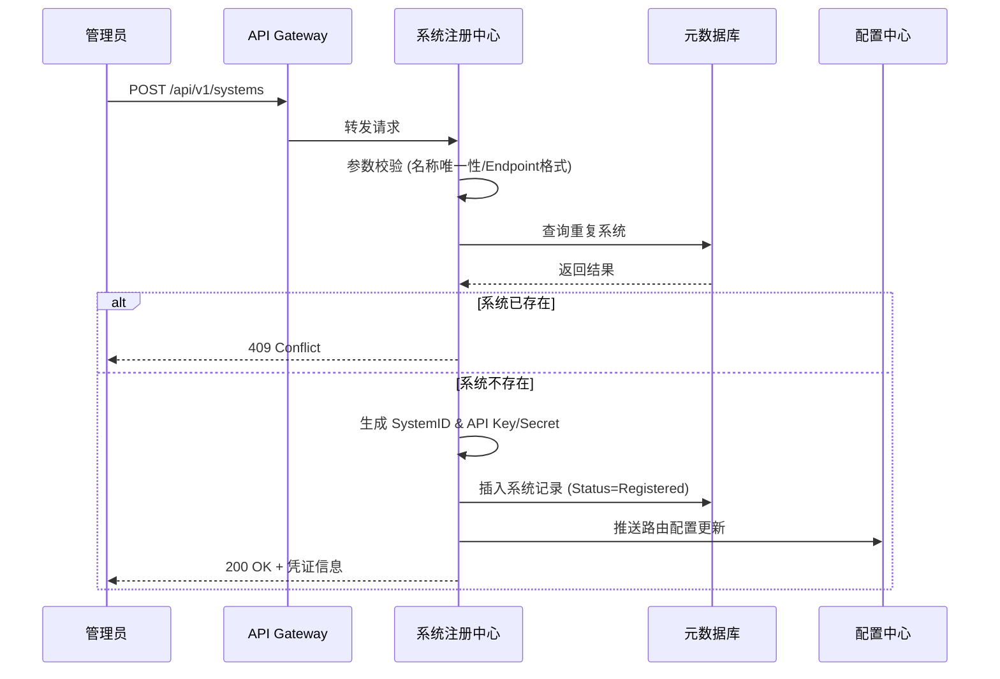
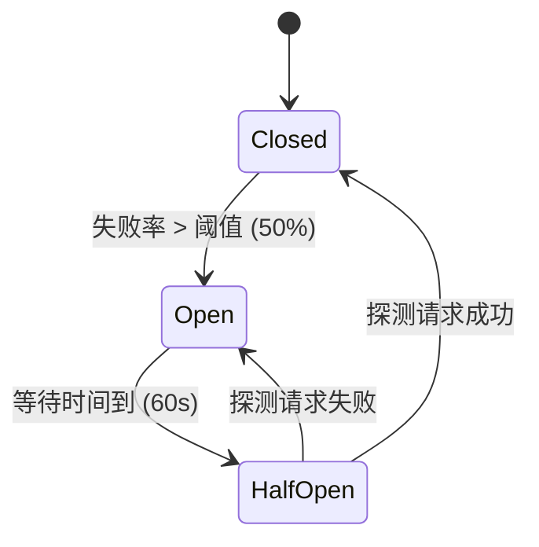
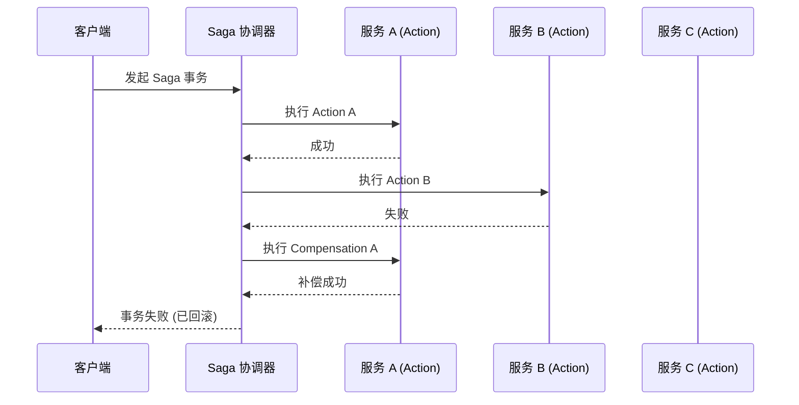
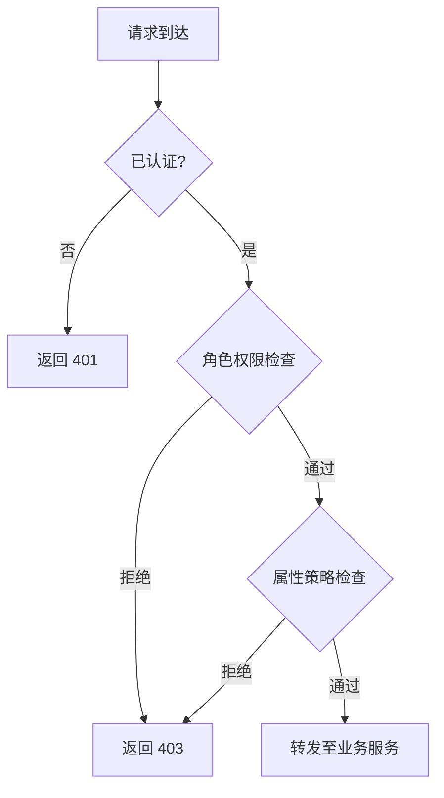

# 企业多系统连接中枢 — 功能设计说明书

> **文档版本**: V1.0  
> **编制日期**: 2026-04-10  
> **关联文档**: 《系统设计文档 V1.0》  
> **密级**: 内部公开  

---

## 1. 引言

### 1.1 编写目的
本文档旨在详细描述"企业多系统连接中枢"各功能模块的内部逻辑、数据结构、处理流程及接口定义，为开发团队提供详细的编码依据，为测试团队提供测试用例设计基础。

### 1.2 范围
本文档覆盖系统设计文档中定义的 7 大核心模块及其 28 个子模块的详细功能设计。

### 1.3 术语与缩写
| 术语 | 含义 |
|------|------|
| Connector | 连接器，用于适配特定外部系统的插件 |
| Pipeline | 数据处理管道，由多个处理节点组成的执行流 |
| TraceID | 全链路追踪唯一标识 |
| Saga | 一种分布式事务模式，通过补偿操作保证最终一致性 |
| RBAC | 基于角色的访问控制 |
| ABAC | 基于属性的访问控制 |

---

## 2. M1 接入管理模块详细设计

### 2.1 M1-1 系统注册中心

#### 2.1.1 功能描述
管理接入中枢的外部系统的元数据注册、状态维护、生命周期管理。

#### 2.1.2 业务流程


#### 2.1.3 数据结构
**SystemEntity**:
| 字段名 | 类型 | 必填 | 说明 |
|--------|------|------|------|
| system_id | String (UUID) | 是 | 主键 |
| system_name | String (64) | 是 | 系统名称，唯一索引 |
| system_type | Enum | 是 | ERP/CRM/HRM/OA/WMS/Custom |
| protocol | Enum | 是 | REST/gRPC/AMQP/WebSocket |
| endpoint | String (255) | 是 | 接入地址 |
| auth_config | JSON | 是 | 认证配置 (加密存储) |
| status | Enum | 是 | Registered/Active/Inactive/Maintenance |
| rate_limit_config | JSON | 否 | 限流配置 |
| created_at | Timestamp | 是 | 创建时间 |
| updated_at | Timestamp | 是 | 更新时间 |

#### 2.1.4 接口定义
-   **POST /api/v1/systems**: 注册新系统
-   **GET /api/v1/systems/{id}**: 获取系统详情
-   **PUT /api/v1/systems/{id}**: 更新系统配置
-   **DELETE /api/v1/systems/{id}**: 注销系统 (软删除)
-   **POST /api/v1/systems/{id}/status**: 变更状态 (Active/Inactive)

### 2.2 M1-2 API 注册管理

#### 2.2.1 功能描述
管理接入系统暴露的 API 定义，支持 OpenAPI 3.0 规范导入，自动生成 API 文档和 Mock 服务。

#### 2.2.2 核心逻辑
1.  **解析**: 接收 OpenAPI YAML/JSON，解析 Paths, Methods, Schemas, Security。
2.  **校验**: 检查 API 路径冲突、参数合法性、Schema 循环引用。
3.  **存储**: 将 API 定义存储为版本化记录。
4.  **同步**: 将 API 路由规则同步至 API 网关 (APISIX)。
5.  **Mock**: 根据 Schema 自动生成 Mock 响应数据。

#### 2.2.3 数据结构
**ApiDefinition**:
| 字段名 | 类型 | 说明 |
|--------|------|------|
| api_id | UUID | 主键 |
| system_id | UUID | 外键，关联所属系统 |
| path | String | API 路径 |
| method | Enum | GET/POST/PUT/DELETE/PATCH |
| version | String | 语义化版本号 |
| openapi_spec | JSON | 原始 OpenAPI 片段 |
| mock_enabled | Boolean | 是否开启 Mock |
| mock_response | JSON | Mock 响应模板 |

### 2.3 M1-3 连接器管理

#### 2.3.1 功能描述
管理连接器的生命周期，包括连接器模板库、实例化、配置、启停。

#### 2.3.2 连接器架构
采用插件化架构，连接器实现标准接口 `IConnector`:
```java
public interface IConnector {
    void initialize(Config config);
    ConnectionStatus connect();
    void disconnect();
    Message send(Message msg);
    Message receive();
    HealthCheckResult healthCheck();
}
```

#### 2.3.3 预置连接器清单
| 连接器名称 | 协议 | 认证方式 | 特性 |
|------------|------|----------|------|
| SAP RFC Connector | RFC | User/Password | 支持 BAPI 调用 |
| Salesforce Connector | REST | OAuth 2.0 | 支持 Bulk API |
| MySQL CDC Connector | Binlog | User/Password | 实时数据捕获 |
| Kafka Connector | Kafka | SASL/SSL | 高吞吐读写 |
| HTTP Generic Connector | HTTP | Basic/Bearer | 通用 HTTP 调用 |

### 2.4 M1-4 协议适配器

#### 2.4.1 功能描述
实现不同协议之间的消息格式转换和传输适配。

#### 2.4.2 适配策略
-   **HTTP ↔ gRPC**: 使用 `grpc-gateway` 或自定义 Transcoder，将 HTTP JSON 映射到 gRPC Protobuf。
-   **HTTP ↔ AMQP**: 将 HTTP Request Body 封装为 AMQP Message，Header 映射为 Properties。
-   **WebSocket ↔ HTTP**: 维护 WebSocket Session，将 WS Message 转发为 HTTP Request，响应回推 WS。

---

## 3. M2 路由与负载均衡模块详细设计

### 3.1 M2-1 动态路由引擎

#### 3.1.1 功能描述
根据请求特征 (Header, Path, Body, User) 动态匹配路由规则，将请求分发至目标服务。

#### 3.1.2 路由匹配算法
采用 **规则树 (Rule Tree)** 匹配算法，优先级顺序:
1.  **精确匹配**: Path 完全匹配。
2.  **前缀匹配**: Path 前缀匹配。
3.  **正则匹配**: Path 正则表达式匹配。
4.  **Header 匹配**: 特定 Header 值匹配 (用于灰度/多租户)。
5.  **权重路由**: 按配置权重随机分发。

#### 3.1.3 路由规则模型
```json
{
  "rule_id": "rule_001",
  "priority": 100,
  "match_conditions": [
    {"type": "path", "operator": "prefix", "value": "/api/v1/orders"},
    {"type": "header", "key": "X-Tenant-ID", "operator": "eq", "value": "tenant_A"}
  ],
  "actions": [
    {"type": "route", "target": "service_order_v2"},
    {"type": "rewrite_path", "pattern": "^/api/v1", "replacement": "/internal/v2"}
  ]
}
```

### 3.2 M2-2 负载均衡器

#### 3.2.1 功能描述
在多个服务实例间分发请求，提高系统吞吐量和可用性。

#### 3.2.2 负载均衡策略
| 策略 | 算法描述 | 适用场景 |
|------|----------|----------|
| Round Robin | 轮询分发 | 实例性能一致 |
| Weighted Round Robin | 按权重轮询 | 实例性能不一致 |
| Least Connections | 分发至连接数最少的实例 | 长连接场景 |
| Consistent Hashing | 基于 Key (如 UserID) 哈希路由 | 会话保持、缓存友好 |
| Random | 随机选择 | 简单场景 |

#### 3.2.3 健康检查联动
负载均衡器实时监听健康检查服务状态，自动剔除 `Unhealthy` 节点，流量不再分发。

### 3.3 M2-3 流量控制

#### 3.3.1 功能描述
保护后端服务免受过载请求冲击，实现限流、熔断、降级。

#### 3.3.2 限流算法
-   **令牌桶 (Token Bucket)**: 允许突发流量，适合 API 网关入口限流。
    -   参数: `capacity` (桶容量), `refill_rate` (填充速率)。
-   **滑动窗口 (Sliding Window)**: 精确控制单位时间请求数。
    -   参数: `window_size` (窗口大小), `max_requests` (最大请求数)。

#### 3.3.3 熔断器状态机


### 3.4 M2-4 灰度发布

#### 3.4.1 功能描述
支持按流量比例或用户标签将部分流量路由至新版本服务。

#### 3.4.2 灰度策略
-   **百分比灰度**: `Canary: 10%`, `Stable: 90%`。基于随机数或 UserID 哈希决定。
-   **标签灰度**: Header `X-Canary: true` 或 `X-User-Group: beta` 路由至 Canary 版本。
-   **流量镜像**: 复制一份流量发送至新版本，新版本响应丢弃，用于无损验证。

---

## 4. M3 数据集成模块详细设计

### 4.1 M3-1 数据转换引擎

#### 4.1.1 功能描述
实现异构数据格式之间的实时转换，支持 JSON, XML, CSV, Protobuf 等格式。

#### 4.1.2 转换流程


#### 4.1.3 转换函数库
| 函数类别 | 函数示例 | 说明 |
|----------|----------|------|
| 字符串 | `upper()`, `lower()`, `trim()`, `substring()` | 字符串处理 |
| 数值 | `add()`, `multiply()`, `round()`, `format()` | 数值计算 |
| 日期 | `date_format()`, `date_add()`, `now()` | 日期时间处理 |
| 逻辑 | `if_else()`, `coalesce()`, `is_null()` | 逻辑判断 |
| 集合 | `map()`, `filter()`, `join()`, `split()` | 数组/列表处理 |

### 4.2 M3-2 字段映射引擎

#### 4.2.1 功能描述
提供可视化字段映射配置，支持源字段到目标字段的一对一、一对多、多对一映射。

#### 4.2.2 映射表达式
支持 JSONPath 和自定义表达式:
-   **简单映射**: `$.source.name` -> `$.target.full_name`
-   **转换映射**: `$.source.amount` -> `$.target.amount_usd` (表达式: `$ * 0.14`)
-   **常量映射**: `$.target.source_system` -> `"ERP"`
-   **嵌套映射**: `$.source.address.city` -> `$.target.city`

#### 4.2.3 映射执行逻辑
1.  加载映射规则。
2.  构建映射执行计划 (DAG)。
3.  遍历源数据，按 DAG 顺序执行转换。
4.  组装目标数据。

### 4.3 M3-3 数据校验引擎

#### 4.3.1 功能描述
在数据转换前后进行数据质量校验，拦截非法数据。

#### 4.3.2 校验规则类型
| 规则类型 | 配置示例 | 说明 |
|----------|----------|------|
| 必填校验 | `{"field": "email", "required": true}` | 字段不能为空 |
| 格式校验 | `{"field": "email", "pattern": "^[a-zA-Z0-9_.+-]+@[a-zA-Z0-9-]+\.[a-zA-Z0-9-.]+$"}` | 正则匹配 |
| 范围校验 | `{"field": "age", "min": 0, "max": 150}` | 数值范围 |
| 枚举校验 | `{"field": "status", "enum": ["A", "B", "C"]}` | 值必须在枚举中 |
| 自定义脚本 | `{"field": "amount", "script": "return $ > 0 && $ < 1000000;"}` | Groovy/JS 脚本 |

#### 4.3.3 校验失败处理策略
-   **Reject**: 拒绝整条消息，进入死信队列 (DLQ)。
-   **Default**: 使用默认值替换。
-   **Ignore**: 忽略该字段，继续处理。
-   **Alert**: 记录告警，继续处理。

### 4.4 M3-4 批量处理引擎

#### 4.4.1 功能描述
处理大数据量同步任务，支持分片、并行处理、断点续传。

#### 4.4.2 批量处理流程
1.  **分片 (Sharding)**: 按 ID 范围或时间窗口将数据切分为多个 Chunk。
2.  **分发**: 将 Chunk 分发至多个 Worker 节点并行处理。
3.  **处理**: Worker 执行 Extract-Transform-Load (ETL)。
4.  **聚合**: 收集各 Chunk 处理结果，汇总状态。
5.  **重试**: 失败 Chunk 自动重试 (最多 3 次)。

#### 4.4.3 性能指标
-   单节点处理能力: 10,000 条/秒。
-   支持水平扩展，线性提升吞吐量。

---

## 5. M4 流程编排模块详细设计

### 5.1 M4-1 BPMN 设计器

#### 5.1.1 功能描述
基于 Web 的可视化流程建模工具，支持 BPMN 2.0 标准。

#### 5.1.2 核心组件
-   **画布**: 基于 `bpmn-js` 实现，支持拖拽节点、连线。
-   **属性面板**: 配置节点属性 (Service Task 的 API 调用参数、User Task 的表单等)。
-   **验证器**: 实时校验流程语法 (如: 开始事件唯一性、网关分支条件完整性)。
-   **版本管理**: 流程定义版本化，支持回滚。

### 5.2 M4-2 流程执行引擎

#### 5.2.1 功能描述
解析并执行 BPMN 流程定义，管理流程实例状态。

#### 5.2.2 执行机制
-   基于 **Zeebe** 引擎，采用事件驱动架构。
-   流程实例状态持久化至 Elasticsearch。
-   支持同步调用和异步 Job 模式。

#### 5.2.3 节点类型支持
| 节点类型 | 说明 | 实现方式 |
|----------|------|----------|
| Service Task | 调用外部服务/API | Job Worker 模式 |
| User Task | 人工审批节点 | 待办任务推送至 OA |
| Script Task | 执行脚本逻辑 | Groovy/JS 引擎 |
| Receive Task | 等待外部事件 | 消息订阅 |
| Send Task | 发送消息/事件 | 消息发布 |
| Sub-Process | 子流程 | 嵌套流程实例 |
| Call Activity | 调用全局流程 | 流程引用 |

### 5.3 M4-3 Saga 事务协调器

#### 5.3.1 功能描述
管理跨系统的分布式长事务，保证最终一致性。

#### 5.3.2 Saga 模式
-   **Choreography (编排式)**: 各服务监听事件并执行，去中心化。
-   **Orchestration (协同式)**: 中央协调器 (Saga Orchestrator) 指挥各服务执行。本系统采用协同式。

#### 5.3.3 事务执行流程


#### 5.3.4 补偿机制
-   每个 Action 必须定义对应的 Compensation Action。
-   补偿失败时，进入人工干预队列，重试或标记异常。

### 5.4 M4-4 事件驱动编排器

#### 5.4.1 功能描述
基于 CloudEvents 标准，实现事件触发的流程执行。

#### 5.4.2 事件模型
```json
{
  "specversion": "1.0",
  "type": "com.example.order.created",
  "source": "/erp/system",
  "id": "evt_123456",
  "time": "2026-04-10T10:00:00Z",
  "data": {
    "order_id": "ORD-001",
    "amount": 1000.00
  }
}
```

#### 5.4.3 订阅与路由
-   支持基于事件类型、Source、属性的订阅过滤。
-   事件匹配后，触发对应的流程实例或调用下游服务。

---

## 6. M5 安全管控模块详细设计

### 6.1 M5-1 统一认证服务

#### 6.1.1 功能描述
提供统一的身份认证能力，支持 OAuth 2.0, OIDC, SAML 2.0。

#### 6.1.2 认证流程 (OAuth 2.0 Authorization Code)
1.  客户端重定向至 Keycloak 登录页。
2.  用户输入凭证，Keycloak 验证通过。
3.  Keycloak 返回 Authorization Code 至回调地址。
4.  客户端使用 Code + Client Secret 换取 Access Token。
5.  客户端携带 Access Token 访问 API。

#### 6.1.3 Token 管理
-   **Access Token**: JWT 格式，有效期 1 小时，包含用户信息和权限。
-   **Refresh Token**: 有效期 7 天，用于刷新 Access Token。
-   **Token 吊销**: 支持黑名单机制，用户登出或密码修改时立即失效。

### 6.2 M5-2 权限管理服务

#### 6.2.1 功能描述
实现细粒度的访问控制，支持 RBAC 和 ABAC 混合模型。

#### 6.2.2 权限模型
-   **RBAC**: 用户 -> 角色 -> 权限 (API 级别)。
-   **ABAC**: 基于属性 (用户部门、数据敏感度、时间、IP) 动态决策。

#### 6.2.3 鉴权流程


#### 6.2.4 策略定义 (OPA Rego)
```rego
package api.authz

default allow = false

allow {
    input.user.roles[_] == "admin"
}

allow {
    input.user.department == input.resource.department
    input.action == "read"
    time.now_ns() < input.resource.expiry_time
}
```

### 6.3 M5-3 加解密服务

#### 6.3.1 功能描述
提供数据加密、解密、签名、验签能力。

#### 6.3.2 加密算法
| 场景 | 算法 | 密钥管理 |
|------|------|----------|
| 传输加密 | TLS 1.3 | 证书管理 (Let's Encrypt / 内部 CA) |
| 存储加密 | AES-256-GCM | Vault 动态密钥，定期轮换 |
| 密码存储 | Argon2id / BCrypt | 盐值随机生成 |
| 数据签名 | RSA-SHA256 / ECDSA | 私钥 Vault 存储，公钥分发 |

#### 6.3.3 敏感数据脱敏
-   **静态脱敏**: 数据库存储时脱敏 (如手机号中间 4 位 `****`)。
-   **动态脱敏**: API 响应时根据用户权限动态脱敏。

### 6.4 M5-4 审计日志服务

#### 6.4.1 功能描述
记录所有关键操作日志，确保不可篡改，满足合规审计要求。

#### 6.4.2 日志内容
| 字段 | 说明 |
|------|------|
| trace_id | 请求追踪 ID |
| user_id | 操作用户 ID |
| action | 操作类型 (Create/Update/Delete/Login) |
| resource | 操作资源 (SystemID/APIPath) |
| ip_address | 客户端 IP |
| timestamp | 操作时间 |
| result | 操作结果 (Success/Failure) |
| details | 详细信息 (JSON) |

#### 6.4.3 防篡改机制
-   日志写入后立即计算哈希值，并与前一条日志哈希链接 (类似区块链结构)。
-   日志存储采用 WORM (Write Once Read Many) 策略。

---

## 7. M6 可观测性模块详细设计

### 7.1 M6-1 指标采集服务

#### 7.1.1 功能描述
采集系统运行指标，暴露 Prometheus 格式 Metrics。

#### 7.1.2 核心指标
| 指标名称 | 类型 | 说明 | 标签 |
|----------|------|------|------|
| `http_requests_total` | Counter | HTTP 请求总数 | method, path, status_code |
| `http_request_duration_seconds` | Histogram | 请求耗时分布 | method, path |
| `active_connections` | Gauge | 当前活跃连接数 | system_id |
| `message_processing_latency_ms` | Histogram | 消息处理延迟 | connector_id |
| `error_rate_total` | Counter | 错误总数 | error_type, component |

#### 7.1.3 采集频率
-   系统指标: 15s。
-   业务指标: 实时或 1min。

### 7.2 M6-2 链路追踪服务

#### 7.2.1 功能描述
基于 OpenTelemetry 标准，实现全链路调用追踪。

#### 7.2.2 Trace 传播
-   网关生成 `TraceID` 和 `SpanID`。
-   通过 HTTP Header `traceparent` 或 gRPC Metadata 透传。
-   各组件创建子 Span，记录开始/结束时间、属性、事件。

#### 7.2.3 采样策略
-   **全量采样**: 开发/测试环境。
-   **概率采样**: 生产环境 (如 10%)。
-   **自适应采样**: 错误请求 100% 采样，正常请求低采样率。

### 7.3 M6-3 日志聚合服务

#### 7.3.1 功能描述
收集、解析、存储多源日志，支持全文检索和分析。

#### 7.3.2 日志采集架构
-   **Agent**: Fluent Bit 部署在每个 Pod/Node，采集容器日志。
-   **Buffer**: Kafka 缓冲日志流，防止背压。
-   **Processor**: Logstash/Fluentd 解析日志 (JSON/Grok)，丰富字段。
-   **Storage**: Elasticsearch 存储索引。
-   **Visualization**: Kibana 展示。

#### 7.3.3 日志规范
所有服务必须输出 JSON 格式日志，包含标准字段:
```json
{
  "timestamp": "2026-04-10T10:00:00.000Z",
  "level": "INFO",
  "service": "data-integration",
  "trace_id": "abc-123",
  "span_id": "def-456",
  "message": "Data mapping completed",
  "context": {"source": "ERP", "target": "CRM", "records": 100}
}
```

### 7.4 M6-4 智能告警服务

#### 7.4.1 功能描述
基于规则或异常检测，实时触发告警通知。

#### 7.4.2 告警规则配置
```yaml
alert: HighErrorRate
expr: rate(http_requests_total{status=~"5.."}[5m]) / rate(http_requests_total[5m]) > 0.05
for: 2m
labels:
  severity: critical
annotations:
  summary: "High error rate on {{ $labels.path }}"
  description: "Error rate is {{ $value }}% for more than 2 minutes."
```

#### 7.4.3 告警收敛与降噪
-   **分组**: 相同规则的告警合并为一条。
-   **抑制**: 高级别告警触发时，抑制相关低级别告警 (如: 节点宕机抑制服务不可用)。
-   **静默**: 维护窗口期间静默告警。

#### 7.4.4 通知渠道
-   邮件、短信、Webhook (钉钉/企业微信/Slack)、电话 (P1 级)。

---

## 8. M7 运维管理模块详细设计

### 8.1 M7-1 配置管理中心

#### 8.1.1 功能描述
集中管理系统配置，支持热更新、版本回滚、灰度配置。

#### 8.1.2 配置模型
-   **层级**: Namespace -> Group -> DataID -> Content。
-   **格式**: YAML, JSON, Properties, XML。
-   **监听**: 客户端长轮询或 gRPC Stream 监听配置变更。

#### 8.1.3 热更新流程
1.  管理员修改配置并发布。
2.  配置中心推送变更通知至订阅客户端。
3.  客户端拉取新配置，校验格式。
4.  客户端应用新配置，无需重启。
5.  客户端上报应用结果。

### 8.2 M7-2 健康检查服务

#### 8.2.1 功能描述
定期检测各组件健康状态，为负载均衡和告警提供依据。

#### 8.2.2 检查类型
| 检查类型 | 方式 | 频率 | 阈值 |
|----------|------|------|------|
| Liveness Probe | HTTP GET /healthz | 10s | 连续 3 次失败重启 |
| Readiness Probe | HTTP GET /ready | 5s | 连续 2 次成功上线 |
| Startup Probe | HTTP GET /started | 1s | 启动完成后停止 |
| Deep Check | 依赖服务连通性测试 | 30s | 数据库/MQ 连接测试 |

### 8.3 M7-3 版本管理服务

#### 8.3.1 功能描述
管理 API、组件、配置的生命周期和版本兼容性。

#### 8.3.2 版本策略
-   **语义化版本**: Major.Minor.Patch。
-   **兼容性矩阵**: 维护各版本间的兼容关系，禁止不兼容版本共存。
-   **废弃流程**: 标记 Deprecated -> 公告 90 天 -> 下线。

### 8.4 M7-4 容量管理服务

#### 8.4.1 功能描述
监控系统资源使用趋势，预测容量瓶颈，提供扩容建议。

#### 8.4.2 预测算法
-   基于历史数据 (CPU, Memory, QPS) 使用时间序列预测 (如 Prophet, ARIMA)。
-   预测未来 7 天/30 天资源使用率。

#### 8.4.3 自动扩缩容 (HPA)
-   **触发条件**: CPU > 70% 或 QPS > 阈值 持续 3min。
-   **动作**: 增加 Pod 副本数，步长 2，最大副本数 20。
-   **缩容**: CPU < 30% 持续 10min，逐步减少副本。

---

## 9. 错误处理与异常设计

### 9.1 全局异常处理
所有服务统一使用全局异常拦截器，捕获未处理异常，返回标准错误响应。

### 9.2 错误响应格式
```json
{
  "error": {
    "code": "4001",
    "message": "Data format mismatch",
    "details": "Field 'email' is invalid format",
    "trace_id": "abc-123-xyz",
    "timestamp": "2026-04-10T10:00:00Z"
  }
}
```

### 9.3 重试机制
-   **适用场景**: 网络抖动、临时性服务不可用 (503)。
-   **策略**: 指数退避重试 (Exponential Backoff)，最大重试 3 次。
-   **幂等性**: 所有重试操作必须保证幂等 (通过 Request ID 或 Idempotency Key)。

### 9.4 死信队列 (DLQ)
-   处理失败且重试耗尽的消息进入 DLQ。
-   DLQ 消息保留 30 天，支持人工查看、重放、丢弃。

---

## 10. 性能与优化设计

### 10.1 缓存策略
-   **L1 缓存**: 本地缓存 (Caffeine)，热点配置、字典数据，TTL 5min。
-   **L2 缓存**: 分布式缓存 (Redis)，会话、Token、频繁查询结果，TTL 动态。
-   **缓存一致性**: Cache-Aside 模式，更新 DB 后删除缓存。

### 10.2 数据库优化
-   **索引**: 高频查询字段建立索引，避免全表扫描。
-   **分库分表**: 单表超过 5000 万行时，按 `system_id` 或 `time` 分片。
-   **读写分离**: 读请求路由至从库，写请求路由至主库。

### 10.3 异步处理
-   耗时操作 (如数据转换、批量同步) 异步化，通过消息队列解耦。
-   客户端提交任务后获取 `TaskID`，轮询或 WebSocket 接收结果。

---

## 11. 附录

### A. 数据字典
(此处可链接至详细的数据字典文档)

### B. 接口契约
(此处可链接至 OpenAPI/Swagger 文档)

### C. 配置清单
(此处可链接至配置中心导出文件)

---

> **文档声明**: 本文档为《系统设计文档 V1.0》的详细功能设计补充，开发过程中需严格遵循本文档定义的接口、逻辑和数据结构。任何变更需经过变更评审委员会 (CCB) 审批。